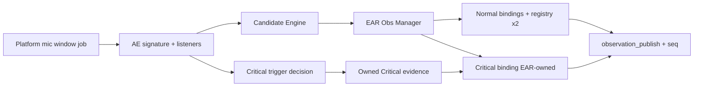

# ADR 0003: Critical Observation Path and shared acoustic evidence

- **Status:** Proposed (lifecycle implementation slice landed in source; auto-detect deferred)
- **Date:** 2026-11-14
- **Revised:** 2026-11-14 (trigger latency measurement; Observation vs evidence capacity / overflow options; lifecycle slice with detection disabled)
- **Depends on:** [ADR 0001](./0001-sensor-platform-architecture.md), [ADR 0002](./0002-audio-and-candidate-engine.md)
- **Firmware Map:** [docs/firmware-map/](../firmware-map/README.md) (composition reference only; Map proposals are not configured)

## Context

EAR already has (source-verified):

- Platform episode registry with **two** normal Observation slots (`SP_OBS_EPISODE_SLOTS`).
- EAR Observation Manager that promote-gates **normal** Observations via CE, binds them to registry slots, and publishes via `dbmap_ear_observation_publish`.
- AE signatures built and published **after** a completed Platform window job (`ae_runtime/ae_device.c`: `sp_mic_take_window_job` → `ae_signature_build` → `ae_publish_signature`), with global history (`AE_HISTORY_CAPACITY` = 32).
- Platform per-channel snapshots (`sp_mic_get_channel` / coherent `sp_mic_take_window_job`) with per-mic RMS/peak/quality and shared `window_seq` / `measured_at_us` for a stereo measure window.
- Default analysis window **1000 ms** (`CONFIG_SP_MIC_WINDOW_MS`).
- Hub Observation ingest with hierarchical v1 schema and `extra="forbid"` on envelope models (`hub/bootstrap/app/schemas.py`).
- Hub already accepts optional `context.origin = "critical_path"` on Observation ingest; EAR Critical lifecycle and `origin` emission are this ADR’s product slice. Still no DoA/TDOA, Analysis Scheduler / Resource Manager, or PAUSE/RESUME in protocol.

**Normal-path END (P1):** Observation Manager owns Observation END. An activity
END hint terminates every open binding immediately (exactly one END each),
including when `ce_live` is true, and clears the local CE association. CE EXIT
remains detach-only and never emits Observation END. Rematch after END cannot
revive a closed Observation.

Product need: capture abrupt HIGH/CRITICAL impulses **without** waiting for normal slots, CE create/promote, or RMS ACTIVE, using the ordinary Observation MQTT envelope, with shared acoustic evidence that survives deferred analysis.

## Decision (proposed)

### 1. Critical Path ownership (EAR product) — preserved

1. **EAR Observation Manager** (or a Manager-owned Critical submodule) owns Critical Observation lifecycle: trigger decision, arm, START, evidence updates, END, cleanup.
2. Critical is **independent of CE lifecycle** (no CE create, `ce_promote`, or CE EXIT required). CE EXIT remains **detach-only** and must never automatically END any Observation.
3. Critical Observations **must not consume** either normal Platform episode-registry slot.
4. Critical must **START while both normal slots are in use**.
5. Publish via `dbmap_ear_observation_publish` (same topic / `message_type: observation` / global seq). Mint UUID with existing helper (`format_uuid_v4` / `sp_ep_uuid_fn`) **without** `sp_episode_registry_allocate` for ID minting.
6. **OTA / shutdown** must END/release Critical bindings (today `ear_observation_close_for_ota` only walks `SP_OBS_EPISODE_SLOTS` — verified gap).

### 2. Critical trigger chain and start latency (completed-window MVP)

**MVP implementation:** Critical detection is initiated from **completed-window** evidence only.

**Proposed chain** (no new acquisition architecture for MVP):

1. **Microphone acquisition** — Platform completes a measure window (`measure_window` / `sp_mic_take_window_job`). Configured window length today: **1000 ms** (`CONFIG_SP_MIC_WINDOW_MS` default) — a `configured` acquisition parameter, **not** a measured Critical latency.
2. **Impulse-relevant evidence** — AE builds/publishes `ae_signature_t` (optional pair metrics from the **same** coherent window job).
3. **Critical trigger decision** — EAR product policy on AE and/or channel features (e.g. crest/peak/quality/flags), **not** gated by CE `min_rms_dbfs`, CE promote, free normal slots, or RMS ACTIVE/ENTER.
4. **Evidence capture/retention** — copy-by-value into Critical-owned evidence (same shared evidence model as §5–§6).
5. **Critical Observation START** — mint UUID; publish via existing path with approved origin field.

| Aspect | Source-verified today | Requires new implementation |
| --- | --- | --- |
| Completed-window AE signatures to listeners | Yes (`ae_device.c`) | Critical listener / armer |
| Coherent per-channel RMS/peak/quality | Yes (`sp_mic_*` window job) | Owned retention |
| Mid-window / pre-finalize detection | **Absent** | Future faster detector (below) |
| Intra-window impulse onset finer than `window_ms` | Not in AE aggregates | Future extraction or shorter windows |
| START without registry slot | Publish API slot-agnostic | Critical binding + OTA walk |

**MVP latency limitation (explicit):**

- Detection waits until the **current acquisition window completes**, then AE publish/processing, then trigger decision, then START publication.
- An acoustic event may therefore wait for the **remainder of the open window** before completed-window evidence exists. A configured **1000 ms** window does **not** mean trigger latency is exactly 1000 ms: delay depends on **where in the window the event occurred**, plus AE/processing and MQTT/publish cost.
- This ADR does **not** describe MVP Critical as immediate or low-latency. **No latency numbers are claimed** without Firmware Map performance records.

**Mandatory measurement requirements** (device soak / lab; record distribution, not averages alone):

| # | Interval | Notes |
| --- | --- | --- |
| 1 | Event occurrence → completed-window availability | Needs a defined event-time reference (lab stimulus / instrumented mark); document method |
| 2 | Completed-window availability → Critical trigger decision | After AE publish / armer entry |
| 3 | Trigger decision → START publication | Through `dbmap_ear_observation_publish` success/attempt policy under test |
| 4 | Event occurrence → START publication | End-to-end sum of the above |

Record test conditions (firmware/platform/IDF/HW profile, window_ms, load: normal Obs open, MQTT, diag) and latency **distribution** (e.g. min / p50 / p95 / p99 / max), not only a mean. Composition: EAR / `esp32-s3-n16r8` / IDF v5.4.4.

**Future faster / mid-window detector:** the architecture **must** allow a later detector to feed the **same** Critical identity, lifecycle, and shared evidence model. It must **not** require a different Observation protocol or a separate Critical reporting architecture. Designing that detector is **out of scope** for this ADR.

### 3. Critical identity and Hub protocol compatibility

1. Critical Observation = ordinary EAR Observation envelope.
2. **Working** mark: optional `context.origin` with working value `critical_path` on **every** Critical report (not START-only). Normal reports **omit** the field unless another origin is explicitly defined later.
3. Field name and enum/string set are **not frozen**. Prefer forward-compatible policy: either a documented open string with Hub validation that accepts known values and has an explicit unknown-value policy, or a versioned enum with planned extension — **approval required**.
4. Hub today **rejects** unknown keys (`ObservationBody` / nested models `extra="forbid"`). **Hub schema + ingest tests must land before firmware emits** the field, unless a separately designed and documented backward-compatibility mechanism exists (none proposed here).
5. Same MQTT topic and ingest path; origin is a handling hint, not a parallel reporting architecture.

### 4. Capacity dimensions, grouping, and overflow evidence

**Three separate architectural dimensions** (do not conflate):

| Dimension | MVP proposal | Meaning |
| --- | --- | --- |
| **Active Critical Observation capacity** | **1** per EAR (`proposed`) | Max concurrent Critical Observations being reported/lifecycled. **Not** “only one real-world event can happen.” |
| **Pending-event capacity** | **Unresolved** | Bound on events waiting to become Observations **without** counting as active Obs. Depth/timeouts not invented here. |
| **Overflow evidence retention capacity** | **Unresolved size**; see options | Bound on **evidence** kept when a new Observation cannot be opened. A bounded evidence buffer is **not** an additional active Observation. |

**Event vs evidence:**

| Case | Required behavior |
| --- | --- |
| Impulses of the **same** sequence | May attach as evidence to the **active** Critical Observation under grouping rules (gap/duration **unresolved**) |
| A **separate** event while another Critical Obs is active | **Never** silently merge; **never** mislabel as another impulse of the active sequence |
| Cannot open another Critical Observation | Apply overflow policy; keep event identity distinct from any retained overflow evidence |

#### Overflow options (conceptual)

| Option | Behavior | RAM / bound | Evidence | Complexity | Confusion risk | Multiple arrivals before capacity free |
| --- | --- | --- | --- | --- | --- | --- |
| **A. Reject + counters only** | No 2nd Obs; diag counters | Lowest | **Loses** timestamp/per-mic content of rejected events | Lowest | Low if counters are clear | Further events only increment counters |
| **B. Reject Obs + bounded overflow evidence snapshot** | No 2nd Obs; store by-value snapshot(s) in shared evidence model | Bounded by snapshot depth (**unresolved**) | Keeps time + per-mic/AE fields for rejected event(s) | Moderate | Low if snapshots tagged as overflow, not Obs | Needs explicit replace/drop policy when snapshot capacity full (**unresolved**) |
| **C. Bounded pending-event evidence queue** | No 2nd **active** Obs; queue event evidence until Obs capacity frees, then may START | Bounded by queue depth (**unresolved**) | Strong retention; deferred Observation | Higher (promotion-from-pending, timeouts) | Medium if pending confused with active Obs | Queue full → same overflow-of-overflow policy needed |

**Recommendation (MVP direction) vs unresolved sizing:**

- **Reject A** as the sole policy if useful acoustic evidence of a concurrent separate event must be preserved: counters alone lose timestamp and per-microphone measurements.
- **Prefer B over C for MVP** unless product requires deferred Observation creation: B keeps **active Observation capacity = 1**, preserves shared-model evidence for rejected separate events, and avoids pending→START state machine complexity.
- **C remains a valid alternative** after RAM/soak analysis if operators need a later Observation for the queued event without raising active capacity.
- **Snapshot/queue depths, retention duration, and RAM budgets remain unresolved.** Source tree has no Critical evidence allocator or measured Critical RAM headroom; Firmware Map soak (heap/SPIRAM under dual normal Obs + Critical) must inform bounds before acceptance of numeric limits.

**Observable overflow:** whenever a separate event cannot become an active Critical Observation, the design must expose an **observable overflow condition** (diag counter and/or retained overflow evidence tagged as such). If a build were forced to A-only, document explicitly what is lost (event time, per-mic levels, signature features).

Grouping / site context (e.g. shooting range) remain product/unresolved.

### 5. Per-microphone evidence integrity

Retained per-mic evidence (Critical-owned, by value) must preserve:

- Microphone identity (`index` / slot contract).
- Measurement values and units (e.g. dBFS digital FS — not SPL unless calibrated).
- Timestamp or measurement interval (`measured_at_us` / `window_end_mono_us`, `window_ms`).
- Correlation id (`window_seq` where available).
- Quality/validity (channel presence, clip, transport/mic status, AE quality/flags).
- **Sync class:** whether values come from the **same synchronized acquisition window** vs separate near-in-time snapshots.

**Never** label asynchronous `get_channel` reads taken at different times as synchronized stereo evidence. Prefer `sp_mic_take_window_job` / AE pair filled from a coherent job (`sp_mic_window_job_channels_coherent`).

| Field / concept | Available today | Needs Critical implementation |
| --- | --- | --- |
| `index`, RMS/peak, `window_seq`, `measured_at_us`, presence/clip counters | `sp_mic_channel_t` | Copy into Critical evidence objects |
| mic0/mic1 RMS/peak + `pair_valid` / stereo_degraded | `ae_pair_metrics_t` / signature pair fields | Retain on impulse records |
| Combined crest/peak/RMS/bands/quality | `ae_signature_t` | Impulse / window summaries |
| Explicit “sync_class” enum on wire | Not present | Product/schema choice if reported |
| Intra-window impulse list finer than window | Not present | New extraction if required |
| DoA/TDOA | Not present | Future; ΔRMS ≠ DoA |

Survive AE history overwrite, CE slot reuse, and Observation lifecycle by **value ownership** under Critical/Obs bindings — not pointers into AE/CE storage.

**Overflow evidence and the shared model:** overflow / pending stores (options B/C) use the **same** by-value evidence shape (signature summaries, per-mic fields, sync class, quality) as active Critical impulse evidence. Do **not** invent a reduced overflow format unless a concrete measured memory constraint on N16R8 justifies a documented subset. Overflow records must remain distinguishable from active Observation identity (no fake `observation_id` lifecycle).

### 6. Shared evidence vs analysis (preserved)

1. Separate **acquisition/retention**, **analysis scheduling**, **results/reporting**.
2. Deferred DoA or other analysis must not discard retained evidence (including overflow evidence while retained).
3. Future generic Analysis Scheduler / Resource Manager = Platform when justified; **EAR Critical policy stays product**.
4. Analysis may run on device or Hub later; Hub Events still not first-class.

### 7. DoA as shared analysis (preserved)

DoA is shared (not Critical-only); urgency differs (immediate attempt for short HIGH/CRITICAL vs periodic refine for long-lived). Never block CE create/promote. **Not implemented**; any interval (including a possible 3 s lab start) remains **`proposed` only**.

### 8. Lifecycle — Critical vs normal (split)

#### Critical lifecycle (this ADR’s implementation path)

Critical MUST be able to **START, update, and END** without CE creation, promotion, or EXIT. Critical MUST NOT depend on PAUSE/RESUME. END is terminal.

#### Normal Observation lifecycle (P1 implemented)

| Rule | Implication |
| --- | --- |
| EXIT detach-only | Correct; keep |
| Activity END ends all open bindings immediately | No wait on CE EXIT; capacity recovers |
| Rematch after END | Cannot revive closed Obs; new promote = new identity |

CE EXIT remains detach-only under both Critical and normal tracks. Critical
implementation does not depend on this path.

PAUSE/RESUME (future): preserve identity/history; RESUME needs fresh evidence; Hub PAUSE timeout only after successful PAUSE receipt (≠ outage); max duration unspecified. Critical must not require PAUSE.

### 9. Capacity and resource assumptions

| Item | Class | Note |
| --- | --- | --- |
| Normal Platform slots | `configured` = 2 | No third normal slot |
| Active Critical Observation capacity | `proposed` = 1 | Representation limit |
| Pending-event capacity | unresolved | Option C; not an active Obs |
| Overflow evidence retention capacity | unresolved size; prefer option **B** direction | Same evidence model; not an Obs |
| CE candidates | `configured` = 8 | Unrelated |
| Impulse / overflow RAM budgets | unresolved | Measure on N16R8 |
| Analysis Scheduler / RM | not implemented | Future Platform |

## Proposed implementation sequence

Dependency-driven order (Hub before Ear emit of origin):

1. **Hub** schema compatibility and tests for the approved origin field.
2. Critical identity, binding, lifecycle, publication (existing publish/seq; **no origin emit before Hub step 1**).
3. Critical OTA/shutdown cleanup.
4. **Completed-window** trigger + instrumentation for the four latency intervals (§2), including distributions.
5. Owned shared evidence and impulse retention (per-mic integrity, sync class).
6. Capacity vs overflow evidence policy (active Obs = 1; implement chosen B/C mechanics; observable overflow; **no silent merge**).
7. Integration tests with **both normal Platform slots occupied**.
8. Tests with **multiple distinct Critical events** while active Critical capacity is occupied (overflow path).
9. Performance and soak on EAR / `esp32-s3-n16r8` / IDF v5.4.4 (Firmware Map records), including heap/SPIRAM under load to bound evidence capacities.
10. **Future evaluation** of faster/mid-window detection feeding the **same** Critical identity/lifecycle/evidence — without a separate Critical protocol.

**Separate / later:** DoA; Platform Analysis Scheduler / Resource Manager; normal END-without-CE-EXIT; PAUSE/RESUME.

Hub-before-emit remains the hard dependency for origin; other steps may overlap in a branch once Hub is ready.

## Consequences

- Normal two-slot path unchanged for long-lived Observations.
- Critical can proceed without waiting on CE or free slots; MVP detection is **completed-window** only — latency must be measured (four intervals); not marketed as low-latency until then.
- Active Obs capacity stays 1; overflow evidence (if retained) is not a second Observation.
- Protocol/Hub must accept origin before Ear emits it.
- Overflow of a second concurrent Critical Obs is explicit, not silent merge.
- Firmware Map keeps Critical/DoA/scheduler as **`proposed` / not implemented**.

## Alternatives considered

| Alternative | Why not for MVP |
| --- | --- |
| Third Platform Observation slot | Blurs normal capacity; Platform Critical semantics |
| Preempt/PAUSE to free a slot | Critical must not depend on PAUSE; latency |
| Separate MQTT type/topic | Parallel reporting architecture |
| Origin only on START | START loss/prune/reorder; no Obs header table |
| Require CE before Critical | Wrong for abrupt impulses; create-floor coupling |
| Sub-window acquisition rewrite first | Not required to start; measure completed-window path first |
| Always open 2nd Critical Obs | Exceeds proposed capacity; RAM/MQTT load |
| Silent merge of unrelated events when full | Violates separate-event integrity |

## Unresolved decisions (block or condition acceptance)

1. Final origin field name / value set and Hub unknown-value policy.
2. Same-sequence grouping gap/duration.
3. Numeric **overflow evidence** and **pending-event** capacities (B snapshot depth vs C queue depth); confirm B vs C after RAM/soak.
4. Impulse-list max depth / RAM budget.
5. Critical reporting cadence for short events.
6. Normal-path END-without-EXIT — done in P1 (activity END is authoritative).
7. Hub PAUSE timeout (when PAUSE exists).
8. DoA investment timing.
9. Lab method for “event occurrence” timestamps in latency tests (§2).

## Review notes (acceptance checklist)

| Topic | Finding |
| --- | --- |
| Trigger capabilities now | Post-window AE signatures + coherent channel/pair metrics |
| Trigger limitations | Completed-window MVP; remainder-of-window wait; processing/publish add delay; 1000 ms ≠ fixed latency; **unmeasured** |
| Latency measurements required | Four intervals + distributions (§2) |
| Evidence available vs new | Channel + AE exist; owned lists / overflow store / origin need impl |
| Capacity dimensions | Active Obs ≠ pending-event ≠ overflow evidence capacity |
| Overflow | Prefer **B** direction; reject silent merge; A loses evidence; C optional later; sizes unresolved |
| Hub compatibility | `extra=forbid` → schema+tests before Ear emit |
| Lifecycle split | Critical ≠ CE; normal latch/wait-EXIT separate |
| Future mid-window detector | Same Critical architecture/protocol only |

## Implementation gate

**Do not implement** Critical Path, origin emit, DoA, or Resource Manager until this ADR is **Accepted** (or explicitly sliced). Keep status **Proposed** until then. Update Firmware Map `proposed` → `configured` only when source exists.

### Implementation slice (2026-11-14) — landed in source

Explicit slice (not full ADR acceptance):

- Hub + payload: optional `context.origin = critical_path`
- EAR: `ear_critical_path` START/PERIODIC/END, capacity 1, drop-busy (overflow **A**)
- Timing defaults: idle 15 s, max 30 s, PERIODIC 5 s (provisional)
- Auto acoustic detection: **hard-disabled** (no production threshold)
- Experimental idle-reset match params only; not approved detectors
- Device / Hub MQTT Critical verification: **outstanding**

See `firmware/products/dbmap/ear/ear_observation/CRITICAL_PATH.md`.
