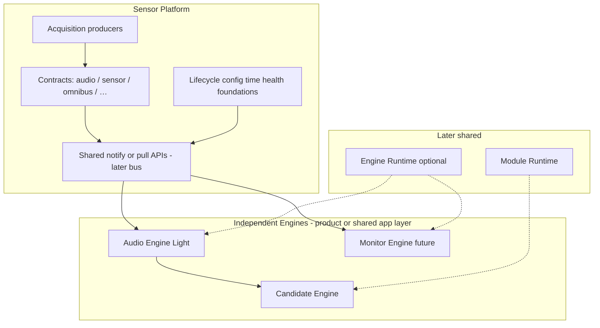
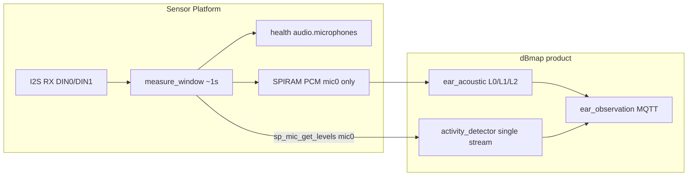
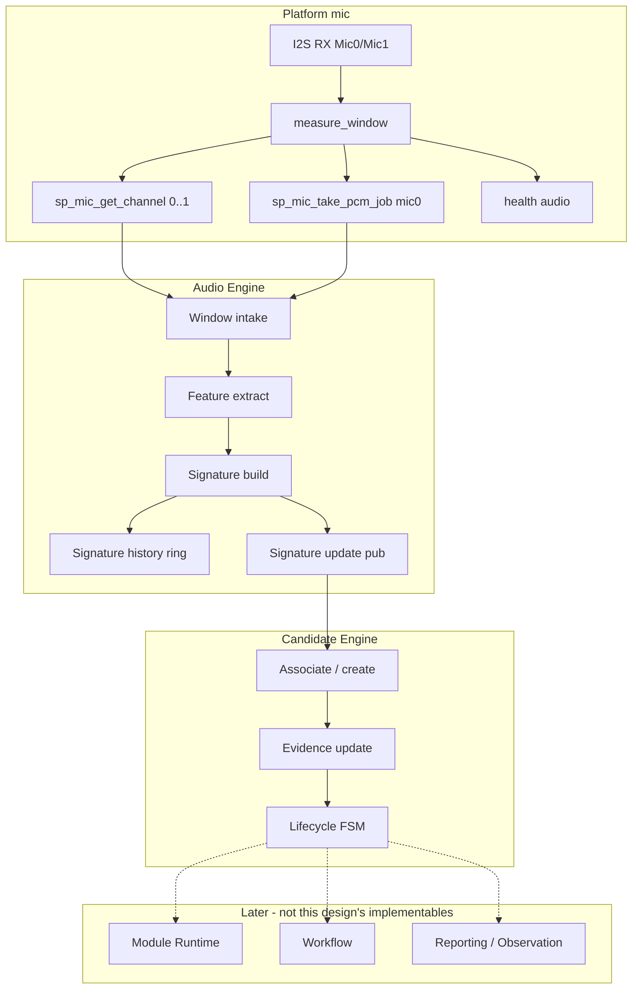
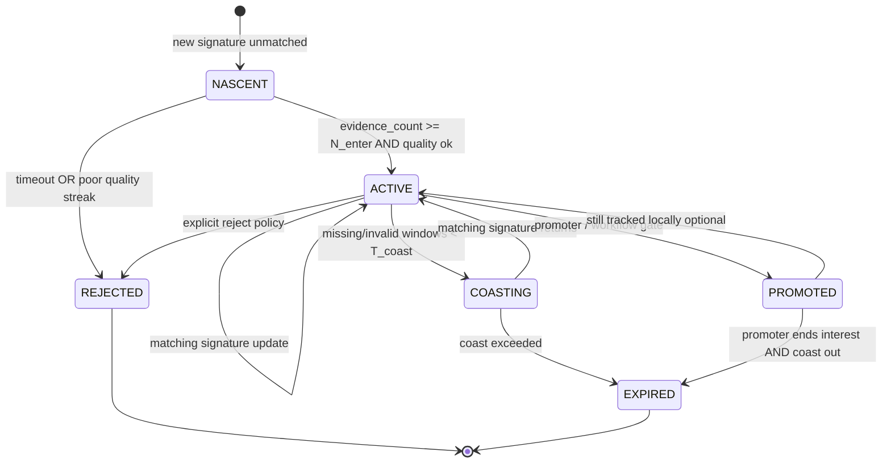
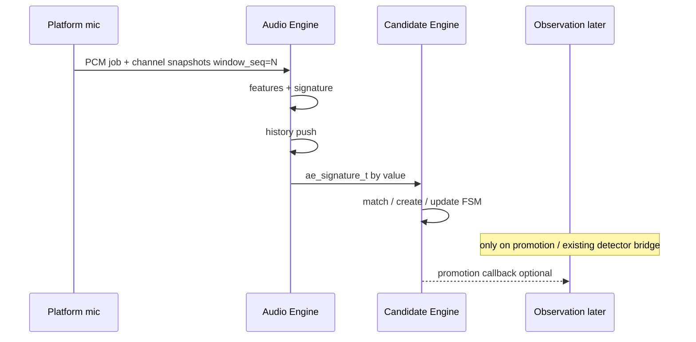
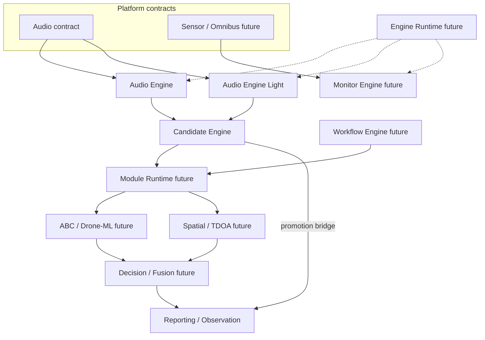

# Audio Engine and Candidate Engine — architecture design

**Status:** Proposed (design only — not implemented)  
**Branch intent:** `firmware/audio-candidate-engine-design`  
**ADR:** [0002](../adr/0002-audio-and-candidate-engine.md)  
**Baseline:** `main` after PR #48 (multi-mic Platform acquisition)  
**Reference IDF:** ESP-IDF 5.4.4 (no migration)

This document is the reviewable architecture for the next Ear firmware layer. It is grounded in the **current** codebase. Capabilities that are not present today are labelled as **reuse**, **extend**, or **new**.

---

## Concept glossary (do not mix)

| Concept | What it is | What it is not |
| --- | --- | --- |
| **Raw samples** | int32 PCM (or I2S slot words) from Platform capture | Features, signatures, candidates |
| **Audio features** | Scalars/vectors from one analysis window (RMS, bands, FFT scalars, …) | A tracked source identity |
| **Acoustic signature** | Quality-gated, versioned feature package for a window (or short chain), with timing + quality | A classifier label (ABC / drone / …) |
| **Candidate** | On-device tracked hypothesis of a continuing acoustic source/event, accumulating signatures | An Observation; Hub Event/Track |
| **Classification result** | Product meaning from a future module (ABC, Drone-ML, …) | Produced by Audio or Candidate Engine |
| **Observation** | Episodic MQTT report (START/PERIODIC/END) with platform envelope + product schemas | Continuous analysis output |
| **Platform contract** | Versioned, domain-neutral data/API surface produced by Platform (e.g. audio window, sensor sample, status event) | Engine-private features or product labels |
| **Engine** | Independent consumer of one or more Platform contracts; owns domain interpretation | Platform acquisition; Hub Observation transport |
| **Module** | Pluggable analyzer/classifier that an Engine or Module Runtime may invoke | Not a second acquisition path |

---

## 0. Multi-engine Platform compatibility (architectural requirement)

Sensor Platform must remain a **generic foundation** for multiple independent Engines and Modules that consume **different** Platform contracts on the same device.

**Illustrative product mix (not implemented here):**

| Engine | Consumes (Platform contracts) | Owns |
| --- | --- | --- |
| **Audio Engine** (this design; full or “Light”) | Audio contract (mic windows, channel metrics, optional PCM) | Acoustic features, signatures, history |
| **Candidate Engine** | Audio Engine signature updates (engine-to-engine), not raw I2S | Candidate identity / lifecycle |
| **Monitor Engine** (future industrial) | Sensor + Omnibus contracts (values, status, related events) | Monitoring interpretation / thresholds |

Engines **may run concurrently**. Platform must not embed product-specific audio analysis or monitoring logic. This design must **not** invent an audio-only bus or runtime that other Engines cannot share.

This section is a **compatibility requirement**. It does **not** request implementing a full Engine Runtime or all transport infrastructure now.

### 0.1 Target shape



### 0.2 What already exists (reuse)

| Capability | Today | Notes |
| --- | --- | --- |
| Audio acquisition + window metrics | `firmware/platform/mic` (`sp_mic_*`) | Strong **audio contract seed** (pull APIs + health JSON) |
| Analysis PCM hand-off | `sp_mic_pcm.h` (`sp_mic_take_pcm_job`) | Single-consumer job queue pattern — mic0 only |
| Health enricher table | `sp_health_add_enricher` / `sp_health_set_enricher` | Multiple components can contribute Reported State fields |
| Device lifecycle / config / time | `node_common` (NVS, Desired, NTP/`sp_time`, OTA, MQTT) | Shared across products |
| Observation foundation | `platform/observation` | Episode/seq/gates — **reporting**, not Engine data plane |
| FreeRTOS / ESP-IDF events | Wi-Fi uses `esp_event`; mic uses task + pull | No unified Platform data-plane bus yet |

**There is no** general Engine registry, cross-contract subscription bus, Omnibus/sensor contract, or Monitor Engine in-tree.

### 0.3 What is missing (gap)

| Gap | Why it matters |
| --- | --- |
| Named, versioned **Platform contracts** beyond ad-hoc headers | Audio vs sensor vs omnibus need stable schemas/IDs for multiple Engines |
| **Multi-subscriber** delivery of contract updates | Today PCM job is single-taker; health is push-to-Hub, not on-device fan-out |
| Generic **Engine lifecycle** (start/stop/health/deps) | Ear boots mic then obs ad hoc in `app_main` |
| Shared **resource policy** (CPU/RAM budgets per Engine) | Concurrent Audio + Monitor must not starve I2S |
| Sensor / Omnibus producers | Required for Monitor Engine; out of scope to invent hardware here |

### 0.4 What to design later as shared Platform capability (not now)

Recommended **future** Platform pieces (separate ADRs when scheduled):

1. **Contract catalog** — e.g. `sp_contract_id_t` + version; audio window snapshot, sensor sample, omnibus status event.
2. **Data-plane notify/pull** — lightweight pub/sub or multi-listener hooks *inside* the device (not MQTT). Pattern: producers publish small descriptors; consumers pull payloads (mirrors today’s PCM job without single-consumer lock-in).
3. **Engine descriptor + health** — register name, contracts consumed/produced, task handle, subsystem status string for enrichers.
4. **Shared clocks** — already partially present (`esp_timer` mono_us, `window_seq`); formalize “contract timestamp” rules for all producers.

**Out of scope for AE/CE v1 implementation:** building that full bus. **In scope for this design:** choose AE↔Platform and AE↔CE shapes that **can migrate** onto it.

### 0.5 Compatibility rules for Audio / Candidate Engine

| Rule | Implication |
| --- | --- |
| AE consumes **Platform audio APIs**, not a private I2S path | Other Engines remain free to consume other contracts |
| AE→CE stays an **engine-to-engine** signature API | Not “the” Platform bus; CE must not require I2S |
| Do not put CE or L0–L2 inside `firmware/platform/mic` | Keeps Platform free of acoustic product logic |
| Prefer **pull + small notify** over AE-owned global queues named “audio only” | Same pattern can later generalize to sensor/omnibus |
| Concurrent Engines | AE must tolerate other tasks; must not assume sole owner of CPU after mic |
| “Audio Engine Light” | Same contracts, fewer features (e.g. L0-only) — still an Engine, not a Platform fork |
| Monitor Engine | Independent; shares Platform lifecycle/time/health foundations only |

### 0.6 How AE/CE map onto the general model

| Component | Role in multi-engine model |
| --- | --- |
| Platform `mic` | **Producer** of the audio contract |
| Audio Engine | **Engine** consuming audio contract; **producer** of signature updates (engine-local contract) |
| Candidate Engine | **Engine** consuming signature updates; **producer** of candidate state for promoters / future Module Runtime |
| Monitor Engine (future) | **Engine** consuming sensor/omnibus contracts — parallel to AE, not behind AE |
| Observation / Reporting | Downstream of promotion — not the Platform data plane |

Candidate Engine is **not** required to be audio-specific forever: its FSM is “evidence over time.” v1 evidence type is acoustic signatures; a later design could generalize evidence adapters without moving CE into Platform.

---

## 1. Current source-code assessment

### 1.1 What exists today



| Layer | Location | Role today |
| --- | --- | --- |
| Mic acquisition | `firmware/platform/mic/ear_mic.c` | Dual STD RX; 1–4 live channels; per-ch RMS/peak/status; bg hist; health enrich |
| Mic public API | `sp_mic.h`, `sp_mic_pcm.h`, `sp_mic_channel_api.h` | `sp_mic_start`, `get_levels` (**mic0**), `get_channel`, `get_stream`, PCM job take |
| Count policy | `sp_mic_count.h` | `SP_MIC_COUNT_MAX=4`, `SP_MIC_ACQUIRE_MAX=4` |
| L0/L1/L2 math | `firmware/products/dbmap/ear/ear_acoustic/` | Host-testable libs + `dbmap_ear_mic_l0_poll` on mic0 PCM |
| Activity | `dbmap_activity_detector.*` | One aggregate RMS activity stream → START/PERIODIC/END |
| Observation | `ear_observation.c` | Episode registry + MQTT publish; `mic_index` hard-coded **0** |
| Platform obs foundation | `firmware/platform/observation/` | Sequence, episode registry, emit gate |

There is **no** Audio Engine or Candidate Engine component. The name “candidate” elsewhere means Rel END baseline samples, Hub firmware catalog candidates, or offline localization script candidates — different concepts.

### 1.2 Timing baseline (measured / configured facts)

| Item | Value | Source |
| --- | --- | --- |
| Capture / analysis window | Default **1000 ms** | `CONFIG_DBMAP_EAR_MIC_WINDOW_MS` |
| Measure wall time | ≈ window length (~1.00–1.01 s) | USB `measure_us` / health `measure_window_us` |
| Mic task | `"sp_mic"`, stack **6144**, delay 20 ms between windows | `ear_mic.c` |
| Observation interval | Default **5000 ms** | `CONFIG_DBMAP_EAR_OBS_INTERVAL_MS` |
| Obs task | `"ear_obs"`, stack **6144**, poll ~100 ms | `ear_observation.c` |
| L0 analyze (device logs) | typically **~55–90 ms** last/max on 1 s PCM | `ear_obs` L0 perf lines |
| L1+L2 fused | typically **~90–120 ms** combined | same |
| L1 workspace | static ~**22.5 KiB** | `dbmap_l1_workspace_t` |
| PCM | 2× SPIRAM buffers ≈ **129 KiB** for 16 kHz × 1 s | boot log `pcm_bytes` |
| CPU % | **Not measured** | Do not invent |

### 1.3 Stereo / multi-mic facts (do not over-claim)

- **DIN0 stereo (Mic 0 L / Mic 1 R):** same I2S controller, same `measure_window`, shared `window_seq` and `measured_at_us`. Samples are interleaved L/R per IDF Philips contract. This is **window-aligned stereo** suitable for energy comparison. Sample-clock identity within the pair follows one RX DMA stream — treat as **implementation-aligned on one DIN**, not independently verified with a scope on every board.
- **DIN1 (Mic 2/3):** second controller, slave clocks. Sample counts can differ slightly from DIN0 in the same wall window. **Not** a verified TDOA path.
- **Analysis PCM:** Platform retains **mic0 / DIN0 left only** (`accumulate_din_slots`). Product L0–L2 therefore see a mono scene today.
- Physical lab posture for this design: **continue with two mics (0/1)**. Four-channel acquisition must not block Audio Engine v1.

### 1.4 Known coupling / gaps

| Gap | Implication for design |
| --- | --- |
| Product paths mic0-centric | Audio Engine v1 should explicitly consume Mic0+Mic1 metrics; stereo PCM is an **extension** of Platform |
| Activity = single stream | Candidate Engine must not be a rename of `dbmap_activity_detector`; migrate carefully |
| Observation = episodic report | Candidate Engine must not publish MQTT Observations |
| Health JSON size | Multi-mic health already pressured Mosquitto packet size; AE/CE must not dump PCM on MQTT |

---

## 2. Proposed component responsibilities

### 2.1 Sensor Platform (unchanged ownership)

**Owns:** microphone hardware lifecycle, I2S/DMA, windowed acquisition, per-channel measurements/diagnostics, health `audio.*`, analysis-PCM hand-off API.

**Must not:** know acoustic events, candidates, classifiers, or Observation policy.

Audio Engine **consumes** Platform via `sp_mic_*` / `sp_mic_pcm_*`. It must not open I2S or duplicate `measure_window`.

### 2.2 Audio Engine (new — application / audio-processing)

**Owns:**

- Pulling completed Platform windows (PCM + channel snapshots).
- Windowing policy for analysis (default: align to Platform 1 s windows).
- Feature extraction (reuse L0/L1/L2 libs; add stereo pair features where justified).
- Building **acoustic signatures** and a bounded **signature history**.
- Data-quality / confidence flags for each signature.
- Publishing signature updates to Candidate Engine (small structs — no PCM copies).

**Must not:**

- Own I2S/DMA.
- Maintain Candidates.
- Emit Observations or Hub MQTT product reports.
- Apply ABC / Drone-ML / VMA labels.

### 2.3 Candidate Engine (new — application)

**Owns:**

- Multiple simultaneous Candidates.
- Create / update / expire / reject / promote (lifecycle).
- Evidence accumulation from signatures.
- Candidate identity and continuity heuristics (lightweight).
- Temporary loss (“coast”) and recovery.

**Must not:**

- Become a second Observation/reporting system.
- Own audio buffers.
- Make final product classification decisions (those belong to future modules / Decision).

### 2.4 Existing product pieces after introduction

| Existing | Role going forward |
| --- | --- |
| `ear_acoustic` L0/L1/L2 **libs** | Reused as Audio Engine’s feature backends (preferred) or called from AE wrappers |
| `dbmap_ear_mic_l0_poll` glue | Eventually absorbed into Audio Engine runtime task/API |
| `dbmap_activity_detector` | Interim promotion/gating path; later a **Workflow/Decision** consumer of Candidates, or replaced by a thin promoter |
| `ear_observation` | Remains Observation publisher; should eventually bind to **promoted** Candidates / track ids, not raw AE spam |

---

## 3. Proposed source placement

Recommended tree (names indicative — not created in this task):

```text
firmware/platform/
  mic/                    # audio contract producer (unchanged ownership)
  observation/            # Observation foundation (reporting), not Engine data plane
  node_common/            # lifecycle, config, time, health enrichers, MQTT
  # later (not now): contract bus / engine registry — shared Platform capability

firmware/products/dbmap/ear/
  ear_acoustic/           # L0/L1/L2 math libs (reusable by Audio Engine)
  audio_engine/           # NEW: Audio Engine (full or Light)
  candidate_engine/       # NEW: Candidate Engine (v1 evidence = signatures)
  ear_observation/        # episodic MQTT; later consume promotions

# future industrial product (illustrative)
# firmware/products/<monitor>/monitor_engine/  # consumes sensor/omnibus contracts
```

**Why Engines stay outside Platform acquisition:** Platform ADR forbids product interpretation in drivers/acquisition. Audio Engine and Monitor Engine are peer Engines on shared Platform foundations; only their **contracts** live in Platform.

**Why not a Platform-only “audio runtime”:** an audio-specific runtime/bus would force Monitor Engine into a second private path and violate the multi-engine requirement (§0).

**Alternative considered:** place engines under `firmware/platform/engines/`. Deferred until a second Engine exists and a shared Engine Runtime ADR is accepted; v1 keeps AE/CE under the dBmap Ear product tree while obeying Platform contract rules.

---

## 4. Audio data-flow design

### 4.1 End-to-end flow



### 4.2 Stage contracts

| Stage | Input | Output | Owner | Timing | Buffering | Validity |
| --- | --- | --- | --- | --- | --- | --- |
| Acquisition | I2S DMA | Per-ch snapshot + optional PCM | Platform | Continuous RX; ~1 s windows | DMA + slot scratch; PCM double-buffer | transport/mic status, sample counts |
| Window intake | `sp_mic_get_stream` + channels + PCM job | `ae_window_view_t` | Audio Engine | Once per completed Platform window | No long PCM retain beyond analyze | Drop if transport error / missing PCM when required |
| Feature extract | PCM (+ ch metrics) | `ae_features_t` | Audio Engine | Same cadence as windows (~1 Hz) | L0 filters + L1 workspace (existing static) | Feature-level validity flags |
| Signature | Features + quality | `ae_signature_t` | Audio Engine | Per accepted window | None beyond hist | Omit/publish invalid |
| Signature history | Signatures | Ring query API | Audio Engine | Append ~1 Hz | Fixed capacity (see §6) | Aged drop |
| CE ingest | Signature updates | Candidate mutations | Candidate Engine | Event-driven on AE publish | Small queue of updates | Ignore invalid; coast on gaps |
| Observation | Promoted candidate / detector | MQTT JSON | `ear_observation` | Episodic / 5 s periodic | Existing rings | Unchanged contract |

### 4.3 Stereo and timing (explicit)

**Association of Mic0 and Mic1**

- Prefer **same `window_seq`** and shared Platform `measured_at_us` from one `measure_window` on DIN0 stereo.
- Timestamp for AE signature: **`window_end_mono_us`** from Platform PCM job when PCM used; else channel snapshot `measured_at_us`. Prefer acquisition-completed time, not “analysis finished” time, so CE timing tracks the acoustic world.
- Analysis duration is recorded separately (`analyze_us`) for diagnostics only.

**Alignment claim level**

- **Claim:** Mic0/Mic1 from DIN0 share one RX stream and one measure deadline → **window-coherent stereo pair**.
- **Do not claim:** verified inter-sample phase for TDOA, or DIN0↔DIN1 coherence.
- **Verification method (future):** capture_diag / host compare of `window_seq`, sample counts, and optional bench tone — not assumed done.

**Dropped / incomplete windows**

- Incomplete stereo trailing words already counted by Platform (`incomplete_stereo_frames`).
- AE: if `sp_mic_take_pcm_job` overwritten (`pending_overwrite`) → emit signature with `quality=stale_or_gap` or skip CE update for that seq; never invent samples.
- If mic1 `disconnected_suspected` while mic0 `signal_present` → stereo features marked degraded; mono primary path may continue.

**Continuity**

- Monotonic `window_seq` from Platform is the primary continuity key.
- AE detects gaps (`seq != last+1`) and flags them on the next signature.

### 4.4 Analysis windows

**Recommendation:** keep **~1 s** Platform-aligned windows as Audio Engine v1 cadence.

| Rationale | Detail |
| --- | --- |
| Matches existing PCM, L0–L2, and device timing budget | L0+L1+L2 already fit in ≪ 1 s wall on S3 (measured analyze_us) |
| Matches human-scale acoustic persistence | Stable enough for energy/spectral tracking without 10× CPU |
| Independent of Hub | Observation interval (5 s) aggregates; AE runs whether MQTT is up |

**Shorter internal windows:** optional later (e.g. 250 ms hop for flux) *inside* AE using retained PCM — **not** required for v1; would need Platform multi-job PCM or AE-owned copy (avoid).

**Overlap:** not for v1 (extra CPU, complex hist). Non-overlapping 1 s windows are enough for Candidate coast/recovery.

---

## 5. Feature and acoustic-signature design

### 5.1 Features for Audio Engine v1

Reuse first; add only what Candidate continuity needs.

| Feature | Source | Purpose | Cost | CE relevance |
| --- | --- | --- | --- | --- |
| RMS / peak / crest | L0 / channel metrics | Energy + clip | Low (existing) | Enter/exit, coast |
| 4-band energies + H/L | L0 | Coarse spectrum shape | Medium (biquads on PCM) | Similarity / change |
| Centroid, bandwidth, dominant Hz, flatness | L1 | Spectral identity cues | High (~FFT 1024) | Continuity / split |
| Spectral flux, envelope CV, dominant Δ | L2 | Change / dynamics | Medium–high (fused path) | Activity vs stable noise |
| Mic0 vs Mic1 ΔRMS / Δpeak | **New** from `sp_mic_get_channel` | Stereo asymmetry without TDOA | Very low | Multi-mic evidence; not DOA |
| Channel quality bits | Platform statuses | Gate learning | None | Reject bad evidence |

**Deferred (not v1):** full stereo FFT, cross-correlation / TDOA, beamforming, ML embeddings, DIN2/3 features as required inputs.

### 5.2 Acoustic signature definition

An **acoustic signature** is a **versioned, quality-gated package of features for one analysis window**, plus timing and continuity metadata. It describes *what the sensors heard in that window*, not *what object it is*.

```c
/* Conceptual — illustrative, not implemented */
typedef struct {
    uint32_t schema_version;       /* ae_signature schema */
    uint32_t window_seq;           /* from Platform */
    int64_t  window_end_mono_us;   /* acquisition-tied */
    uint32_t window_ms;
    uint8_t  mic_mask;             /* bit0=mic0, bit1=mic1, … */
    uint8_t  quality;              /* enum: ok / degraded / gap / invalid */
    uint8_t  flags;                /* clipped, stereo_degraded, … */

    /* Primary scene (typically mic0 PCM-derived) */
    float rms_dbfs, peak_dbfs, crest_db;
    float band_dbfs[4];
    float hl_db; bool hl_valid;
    float centroid_hz, bandwidth_hz, dominant_hz, flatness;
    float spectral_flux, envelope_cv;
    float dominant_delta_hz; bool dominant_delta_valid;

    /* Pair features (mic0/mic1) — optional if mic1 absent */
    float delta_rms_db;            /* mic0 - mic1 */
    float delta_peak_db;
    bool  pair_valid;
} ae_signature_t;
```

**Creation / update:** one new signature per accepted window (immutable snapshot). “Update” means append history + notify CE, not mutate an old signature in place.

**Similarity:** CE may compare consecutive signatures (RMS Δ, band cosine, dominant proximity). AE may expose a helper `ae_signature_distance()` later; v1 can keep distance logic inside CE to avoid circular deps.

**Uncertainty:** encode in `quality` + feature-level validity (e.g. `hl_valid`), not by inventing confidence from classifiers.

---

## 6. Signature-history design

| Property | Recommendation |
| --- | --- |
| Structure | Fixed ring of `ae_signature_t` (by value) |
| Capacity | **32–64** entries (~32–64 s at 1 Hz) — enough for Candidate association and short coast |
| RAM | ~128–256 bytes/signature estimate → **~8–16 KiB** static (refine at impl) |
| Query | Latest N; range by `window_seq` / mono_us |
| Ownership | Audio Engine only; CE receives copies/notifications, does not share mutable ring |
| Persistence | RAM only; no NVS |

---

## 7. Candidate data model

```c
/* Conceptual */
typedef enum {
    AE_CAND_NASCENT = 0,
    AE_CAND_ACTIVE,
    AE_CAND_COASTING,
    AE_CAND_PROMOTED,   /* handed to Observation/Workflow interest */
    AE_CAND_REJECTED,
    AE_CAND_EXPIRED,
} ae_cand_state_t;

typedef struct {
    uint64_t candidate_id;         /* device-local monotonic or UUID-derived */
    ae_cand_state_t state;
    int64_t created_mono_us;
    int64_t last_evidence_mono_us;
    int64_t last_update_mono_us;
    uint32_t evidence_count;
    uint32_t coast_windows;
    float confidence;              /* 0..1 heuristic — not classifier posterior */
    uint8_t quality_summary;
    /* Compact rolling evidence: last signature id/seq, EMA rms, band fingerprint */
    uint32_t last_window_seq;
    float ema_rms_dbfs;
    float band_ema[4];
    uint8_t mic_mask_seen;
} ae_candidate_t;
```

**Capacity:** start with **4–8** simultaneous candidates (static array). Excess → reject weakest / oldest nascent.

**Candidate ≠ Observation:** Observations remain episodic MQTT reports with `observation_id`. A Candidate may later *inspire* an Observation episode (promotion), optionally carrying `track_id` continuity — that binding is Workflow/Reporting work.

---

## 8. Candidate lifecycle and state transitions



| Transition | Condition (v1 heuristic — tunable, not ML) |
| --- | --- |
| Create NASCENT | Signature `quality∈{ok,degraded}`, not associated to existing candidate (distance above threshold) |
| NASCENT→ACTIVE | ≥ `N_enter` consecutive matching windows (e.g. 2–3) with usable energy |
| Update ACTIVE | Signature distance below match threshold to candidate fingerprint |
| ACTIVE→COASTING | Gap flag, invalid window, or mic quality loss while candidate young evidence remains |
| COASTING→ACTIVE | Match returns within `T_coast` windows (e.g. 3–5 s) |
| →EXPIRED | Coast timeout or max age without promotion interest |
| →PROMOTED | External promoter (initially: adapt activity detector thresholds on candidate energy; later Workflow) |
| →REJECTED | Persistent noise fingerprint / policy blacklist (optional; keep minimal in v1) |

**Duplicate avoidance:** association before create; one signature updates at most one candidate per window (best match). Unmatched → new NASCENT (subject to capacity).

**Multiple simultaneous:** separate fingerprints (band EMA + EMA RMS + optional delta_rms). Do not force a single global activity bit inside CE.

**Classification vs lifecycle:** lifecycle answers “is there a continuing acoustic thing?” Classification answers “what is it?” — future modules only.

---

## 9. Audio Engine ↔ Candidate Engine interface

### 9.1 Principles

- AE publishes **signatures** (and optionally raw feature blocks for debug builds), not PCM.
- Timestamps are acquisition-tied (`window_end_mono_us`, `window_seq`).
- Quality is explicit on every update.
- CE is pull-or-queue consumer; never blocks I2S.
- No shared mutable PCM; no large copies.
- AE→CE is an **engine-to-engine** contract, not a replacement for the future Platform multi-contract bus (§0). When a shared bus exists, signature updates may be *optionally* mirrored as an “engine-produced” contract without requiring CE to speak I2S.

### 9.2 Proposed C API (conceptual)

```c
/* audio_engine → world */
esp_err_t ae_start(const ae_config_t *cfg);
esp_err_t ae_poll(void);   /* take Platform window, analyze, append hist, notify */

bool ae_get_latest_signature(ae_signature_t *out);
uint32_t ae_history_copy(ae_signature_t *out, uint32_t max_n);

typedef void (*ae_signature_listener_t)(const ae_signature_t *sig, void *ctx);
esp_err_t ae_add_signature_listener(ae_signature_listener_t fn, void *ctx);

/* candidate_engine */
esp_err_t ce_start(const ce_config_t *cfg);
void ce_on_signature(const ae_signature_t *sig);  /* listener or queue drain */
uint8_t ce_candidate_count(void);
bool ce_get_candidate(uint8_t index, ae_candidate_t *out);
bool ce_find_candidate(uint64_t id, ae_candidate_t *out);

/* Promotion hook — Observation/Workflow later */
typedef void (*ce_promotion_cb_t)(const ae_candidate_t *c, ce_promotion_event_t ev, void *ctx);
```

**Duplicate / repeated updates:** keyed by `window_seq`. CE ignores seq ≤ last processed for that candidate stream; AE never rewinds seq.

**Missing windows:** AE may call `ce_on_gap(last_seq, new_seq)` or encode `quality=gap` on the next signature; CE enters COASTING rather than creating duplicates.

### 9.3 Interface diagram



---

## 10. Timing, concurrency, and performance

### 10.1 Task model (recommended)

| Task | Priority (relative) | Work |
| --- | --- | --- |
| `sp_mic` | Keep high enough for I2S reads | Unchanged acquisition |
| `ae_task` **or** poll from `ear_obs` initially | Below mic, above idle | `ae_poll` + `ce_on_signature` |
| `ear_obs` | As today | Promotion → Observation; MQTT |

**v1 pragmatic option:** run `ae_poll` + CE inside existing `ear_obs` activity loop (already calls `dbmap_ear_mic_l0_poll`) to avoid another stack until proven. **v1.1:** dedicated `ae_task` if obs latency suffers.

### 10.2 Resource estimates (labelled)

| Resource | Estimate | Basis |
| --- | --- | --- |
| CPU | ~same as today’s L0+L1+L2 per second + small CE | Measured analyze_us ≪ 1 s; CE O(candidates×features) tiny |
| RAM signatures | ~8–16 KiB | §6 |
| RAM candidates | < 2 KiB for 8 candidates | struct size estimate |
| Extra PCM | **0** if reuse Platform mic0 PCM | Stereo PCM extend = +1× window if added later |
| Stack | Prefer no large FFT on task stack (L1 already static ws) | Existing pattern |
| Queue | 2–4 signature updates | Overflow: drop oldest update, set CE gap |

**Must not** block `i2s_channel_read` loop or take Platform locks longer than today’s critical sections.

### 10.3 Worst case

- Analysis overrun → Platform `pending_overwrite`; AE must detect and gap-flag (existing overwrite counter).
- MQTT stalls must not stall AE/CE (already true for detection vs publish in Ear).

---

## 11. Future integration points



| Future component | How this design helps |
| --- | --- |
| Platform contract bus | AE already pulls audio contract; pattern reusable for sensor/omnibus |
| Engine Runtime | Registers concurrent Engines; AE/CE/Monitor as peers |
| Module Runtime | Runs modules on Candidate evidence / signature hist without touching I2S |
| Workflow Engine | Enables which modules run; controls promotion policy |
| Decision/Fusion | Consumes module outputs + candidate identity |
| ABC / Drone-ML | Classification modules — inputs are signatures/features, not raw MQTT |
| Spatial | Needs verified multi-mic timing; AE/CE stay unchanged except new feature fields |
| Monitor Engine | Independent consumer of non-audio contracts; not routed through AE |
| Reporting Engine | Publishes Observations from **promoted** results; must not subscribe to every AE tick |

**Stable concepts for later:** Platform contract IDs/versions, `candidate_id`, signature `window_seq` timeline, quality flags, Engine health strings.

---

## 12. Risks, unresolved questions, alternatives

### 12.1 Risks

| Risk | Mitigation |
| --- | --- |
| Treating activity_detector as Candidate Engine | Explicit separate module + lifecycle; bridge only |
| Assuming TDOA-ready stereo | DIN0 window coherence only; spatial deferred |
| Stereo PCM cost | v1 uses mic0 PCM + mic1 metrics; extend Platform PCM API later |
| Confidence number misread as classifier posterior | Document as heuristic; keep schema name `confidence` scoped |
| Health/MQTT bloat | AE/CE state stays on-device; optional diag only |
| Enrich background mic0 gate nuance | Unrelated cleanup; do not block this design |
| Audio-only “runtime” blocking Monitor Engine | Obey §0: shared Platform contracts; AE-private code stays in AE |
| Treating health enrichers as the Engine data plane | Enrichers are Hub telemetry; Engines need on-device pull/notify |

### 12.2 Unresolved (need verification before / during impl)

1. Exact `N_enter`, match distance, and `T_coast` — tune on EAR-001 with two mics.
2. Whether AE gets its own task in v1 or stays polled from `ear_obs`.
3. When Platform should retain stereo PCM (Mic0+Mic1) for AE — recommend a small Platform extension ADR when needed.
4. Mapping `candidate_id` → Observation `track_id` / `observation_id` — Reporting design.
5. Whether L2 publish-to-Hub remains Observation-only (yes for now).
6. When to schedule the shared Platform contract-bus / Engine registry ADR relative to Monitor Engine needs.
7. Whether Candidate Engine evidence adapters generalize beyond audio in the same component or split later.

### 12.3 Alternatives considered

| Alternative | Why not preferred |
| --- | --- |
| Put Audio Engine in Platform | Violates product/interpretation boundary; blocks non-audio Engines |
| Only extend activity_detector | Remains single-stream; hard to multi-candidate |
| Signature = L1 JSON blob only | Loses energy/quality/timing unity CE needs |
| Require 4 mics for AE | Blocks development; contradicted by available hardware |
| Event-per-window MQTT | Bandwidth + conflates Observation with analysis |
| Build full Engine Runtime before AE | Over-scopes; §0 allows designing compatibility first |
| Route Monitor Engine through Audio Engine | Wrong contract; Engines are peers on Platform |

---

## 13. Implementation map (when approved — not now)

| Item | Kind |
| --- | --- |
| `sp_mic_*` acquisition, health, mic0 PCM (audio contract seed) | **Reuse** |
| Health enricher table, device config/time/MQTT | **Reuse** (Platform foundations) |
| L0/L1/L2 analyze functions | **Reuse** |
| `sp_mic_get_channel` for mic1 pair features | **Reuse** |
| Stereo PCM hand-off | **Extend** Platform later |
| Multi-subscriber audio window notify | **Extend** Platform later (toward shared bus) |
| Versioned Platform contract IDs + Engine registry | **New later** (shared Platform capability) |
| Sensor / Omnibus producers + Monitor Engine | **New later** (peer Engine) |
| AE runtime, signature, history | **New** (Engine, not Platform) |
| CE model + FSM | **New** (Engine, not Platform) |
| Bridge activity_detector ↔ CE promotion | **Extend** product obs |
| TDOA / classifiers / Module Runtime / Engine Runtime | **New later** |

### Assumptions still needing verification

- DIN0 L/R physical straps match software left/right contract on the bench board.
- 1 s non-overlapping windows suffice for first multi-candidate demos.
- Existing L0–L2 CPU headroom remains after CE (expected, not re-measured here).

---

## 14. Required diagrams (index)

1. Multi-engine Platform contracts — §0.1  
2. Complete audio data flow — §4.1  
3. Audio Engine internal processing — §4.1 (AE subgraph) + §5  
4. Candidate lifecycle — §8  
5. AE ↔ CE interface — §9.3  
6. Future Engine Runtime / Module / Workflow / Reporting — §11  

---

## 15. Review checklist

- [ ] Multi-engine Platform compatibility (§0) accepted  
- [ ] Exists / missing / later shared Platform capabilities accepted  
- [ ] Responsibilities Platform / AE / CE accepted  
- [ ] Glossary distinctions accepted (including contract / Engine / Module)  
- [ ] 1 s window recommendation accepted or amended  
- [ ] Feature set v1 accepted (including stereo Δ without TDOA)  
- [ ] Candidate FSM accepted as non-Observation  
- [ ] Interface precise enough for independent implementation  
- [ ] Two-mic development constraint accepted  
- [ ] No implementation until this design is reviewed  

**Most important outcome:** coherent, implementable boundaries compatible with concurrent non-audio Engines — not the largest feature set.
