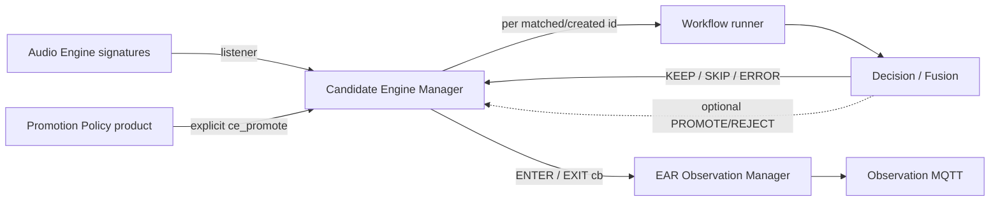

# Candidate Engine — Technical Assessment and Proposal

**Status:** Stages 1–3 implemented on host (firmware + host tests); hardware /
Map verification still outstanding  
**Branch (implementation):** `architecture/candidate-engine-contracts-review`  
**Baseline:** `main` after PR #59 (AS-001 BBC relative-bg assessment)  
**Depends on:** [ADR 0002](../adr/0002-audio-and-candidate-engine.md),
[AE/CE architecture](./audio-and-candidate-engine.md),
[ADR 0003](../adr/0003-critical-observation-path-and-shared-evidence.md) (Critical ≠ CE)

**Scope history:** This document began as analysis-only. The staged plan below
is retained. Implementation status is recorded in [Implementation status
(Stages 0–5)](#implementation-status-stages-0-5) — do not treat unimplemented
stages (4–5) as done.

---

## Glossary (keep distinct)

| Concept | Meaning here |
| --- | --- |
| **Acoustic signature** | AE window package (`ae_signature_t`): features + timing + quality |
| **Candidate** | On-device tracked hypothesis of a continuing acoustic source/event |
| **Observation** | Episodic MQTT report (START/PERIODIC/END) with Hub envelope |
| **Promotion** | Explicit CE → Observation Manager hand-off (`ce_promote` / ENTER) |
| **Legacy RMS Activity Detector** | Single-stream ENTER/EXIT on aggregate RMS (−45 / −55 dBFS) |
| **CE create floor** | `min_rms_dbfs` (−80 default) — NASCENT create gate only, **not** ENTER/EXIT |

Target processing flow (agreed):

```text
Audio Engine → Candidate Engine → Workflow / Decision / Fusion → Promotion → EAR Observation Manager
```

---

## Part 1 — Current implementation assessment

### Source map

| Area | Path | Role |
| --- | --- | --- |
| AE types / signature | `audio_engine/include/ae_types.h`, `ae_signature.c` | Features, distance, usability |
| AE runtime (device) | `ae_runtime/` | Window job → build → publish listeners |
| CE types / façade | `candidate_engine/include/ce_*.h`, `ce_engine.c` | Slots, bind AE, decisions |
| CE Manager | `ce_manager.c` / `ce_manager.h` | Create / match / update / coast / promote / reject |
| Module / Workflow | `ce_module.*`, `ce_workflow.*`, `ce_decision.*` | Static modules; `ce.track` → KEEP/SKIP/ERROR |
| Promotion Policy | `ear_observation/ear_promotion_policy.*` | P2 deny-by-default product-relevance gate: approved ACTIVE → reserve → `ce_promote` (experimental AS-001 allow; soft-skip otherwise) |
| Observation Manager | `ear_obs_manager.*` | Reservation, ENTER/EXIT, Obs create/end, evidence snap; enforces `pending => product_relevance_approved` |
| Legacy bridge (M3) | `ce_promotion_bridge.*` | Association-only; superseded on device by Manager + Policy |
| Legacy RMS detector | `dbmap_activity_detector` + Kconfig −45/−55 | Still runs; START ignored when Manager ready |
| Capacities | `docs/firmware-map/products/dbmap-ear/capacities.md` | CE=8, Obs bind=2, promote sigs≤3 |

Device wire (when `CONFIG_DBMAP_EAR_AUDIO_ENGINE`): `ear_observation.c` starts AE + CE,
`ce_bind_audio_engine`, `ce_set_promotion_cb(…, ear_obs_manager_on_promotion)`,
`ear_promotion_policy_poll` + `ear_obs_manager_poll` each activity loop.

### Answers to the ten assessment questions

#### 1. Where and how is a Candidate created?

**Implemented and working (host + device path).**

- Entry: AE listener → `ce_on_signature` → `ce_engine_on_signature` →
  `ce_manager_ingest`.
- Create path: no in-use candidate within `match_distance_max` →
  `create_nascent()` (`ce_manager.c`).
- Gates: quality ∈ {OK, DEGRADED}; `rms_dbfs >= cfg.min_rms_dbfs` (default
  **−80**, not −45); free slot or evict weakest NASCENT; else drop
  (`CE_INGEST_DROPPED`).
- State: `AE_CAND_NASCENT`, monotonic `candidate_id` from `next_id` (starts at 1).

#### 2. What information from the Audio Engine is currently used?

**Implemented.**

| Field / concept | Used for |
| --- | --- |
| `window_seq` | Global de-dupe / rewind ignore; seq discontinuity → coast all |
| `window_end_mono_us` | Evidence / create / update clocks |
| `quality` | Create gate; GAP → coast-only; INVALID → ignore |
| `rms_dbfs` | Create floor; fingerprint EMA; ranking (`ema_rms_dbfs`) |
| `band_dbfs[4]` | Fingerprint EMA; distance |
| `mic_mask` | OR into `mic_mask_seen` |
| Spectral / pair (dominant, flatness, ΔRMS) | Available in `ae_signature_distance`, **but CE fingerprint proxy zeros them** — match uses RMS+bands only |

CE does **not** consume PCM. History for promotion snapshots comes from AE ring
(`ae_history_copy`, ≤ `EAR_OBS_PROMOTE_SIG_CAP` = 3).

#### 3. How are Candidates identified and distinguished?

**Partially implemented (identity heuristic is weak).**

- **Stable id:** device-local `uint64_t candidate_id` until slot cleared. Not an
  Observation id / Hub track id.
- **Association key:** fingerprint = EMA(RMS) + EMA(4 bands), α=0.35; distance via
  `ae_signature_distance(proxy, sig)` ≤ `match_distance_max` (default 8).
- **One signature → at most one candidate** (best match; ties prefer later slot).
- No spatial identity, no classifier identity, no Hub event id.

#### 4. How is an existing Candidate updated with new evidence?

**Implemented.**

`update_matched`: bump `evidence_count` (NASCENT/ACTIVE/PROMOTED), refresh
fingerprint EMA, quality, last seq/time, heuristic `confidence`
(`evidence_count/10`, degraded ×0.85). COASTING rematch restores PROMOTED if
`promotion_entered`, else ACTIVE (no second ENTER).

#### 5. How are multiple concurrent Candidates handled?

**Implemented at CE capacity; product promotion is capacity-2 Obs.**

- Up to **8** CE slots (`CE_MAX_CANDIDATES`).
- Distinct fingerprints can coexist; unmatched loud signatures create new NASCENT.
- Eviction: only NASCENT with lowest `evidence_count` when full; ACTIVE/PROMOTED
  never evicted for capacity.
- Observation Manager binds at most **2** Observations; Promotion Policy selects
  one new ACTIVE per poll (others already `promotion_entered` are skipped, not
  blocked globally — unlike the older single-Obs bridge).

#### 6. Which Candidate lifecycle states exist?

**Implemented.**

```text
NASCENT → ACTIVE → (PROMOTED) → COASTING ↔ ACTIVE/PROMOTED → EXPIRED
                 ↘ REJECTED
```

Enums in `ce_types.h`: `NASCENT`, `ACTIVE`, `COASTING`, `PROMOTED`, `REJECTED`,
`EXPIRED`. Flag `promotion_entered` survives PROMOTED→COASTING for EXIT.

#### 7. How are timeout, temporary absence and reappearance handled?

**Implemented (coast model).** Defaults: `t_coast=3`, `n_enter=2`.

| Event | Behavior |
| --- | --- |
| `AE_QUALITY_GAP` | Coast all live candidates; do **not** match/create |
| `window_seq` jump > last+1 | One coast step, then process arrived signature |
| ACTIVE/PROMOTED miss | → COASTING (`coast_windows=1`) |
| Further coast | Increment; expire when `coast_windows > t_coast` |
| NASCENT + gap | Expire immediately |
| Rematch within coast | Restore PROMOTED or ACTIVE; clear coast |

**Principle held:** temporary absence does **not** auto-terminate until coast
budget exhausted. CE EXIT never ENDs an Observation by itself (Manager detach
only). Observation END is owned by OM via activity END hints (immediate).

#### 8. How do KEEP, REJECT and PROMOTE work?

**Vocabulary implemented; product promotion is external; track fusion never promotes.**

| Decision | Producer today | Effect |
| --- | --- | --- |
| **KEEP** | `ce.track` fusion (OK/DEGRADED) | No lifecycle change after ingest |
| **SKIP** | GAP short-circuit / conditions | No promote/reject |
| **ERROR** | Unusable / module failure | No lifecycle change |
| **PROMOTE** | Explicit DECIDE step **or** `ear_promotion_policy` → `ce_promote` | ACTIVE/COASTING → PROMOTED + ENTER once |
| **REJECT** | Explicit DECIDE / `ce_reject` / pending timeout | Terminal; EXIT if promoted |

Default workflow **never** emits PROMOTE/REJECT. Device promotion is product
policy ranking ACTIVE candidates (evidence ↓, ema_rms ↓, id ↑) — **not** −45/−55.

#### 9. How is evidence transferred during promotion to the Observation Manager?

**Implemented (by-value snapshot + ongoing EMA refresh).**

1. Policy: `reserve` → `bind_reservation_candidate` → `ce_promote`.
2. ENTER callback → Manager event queue → `handle_enter` →
   `ear_obs_manager_fill_snapshot_from_candidate` (candidate fields + up to 3
   AE history signatures) → `commit_reservation` → Observation START emit.
3. While `ce_live`: `mgr_feed_evidence` refreshes binding snap from live
   candidate (currently **without** per-tick signature copies — `sig_copy=NULL`).
4. EXIT: detach `ce_live` only (never ENDs). Activity END hint ends open
   Observations immediately (OM-owned; does not wait for EXIT).

#### 10. Limitations / incomplete parts

| Item | Status |
| --- | --- |
| AE → CE → Manager pipeline | **Working** (device + host tests) |
| Multi-candidate CE tracking | **Working** (8 slots; host lifecycle tests) |
| Dual Observation promotion | **Working** (Manager capacity 2 + Policy) |
| Workflow that decides PROMOTE/REJECT from modules | **Scaffold only** — track fusion = KEEP |
| Classification modules | **Not implemented** |
| Identity using spectral/pair/spatial | **Partial** — distance API has fields; CE match ignores them |
| Duplicate/split acoustic events | **Heuristic only** — see Part 3 |
| CE EXIT vs Observation END | **Working (P1)** — EXIT detach-only; activity END terminates Obs immediately |
| `identity.track_id` on MQTT | **Not implemented** |
| Evidence ring after promote | **Partial** — history at ENTER; live sig ring not fed each tick |
| Legacy `ce_promotion_bridge` | **Present** (tests / M3); product path uses Manager |
| Critical Path | **Independent of CE** (ADR 0003); auto-detect disabled |
| Hardware verification of multi-candidate demos | **Not claimed verified_operating** |

### Legacy RMS Activity Detector — actual role (do not redefine CE)

When Audio Engine + Obs Manager are enabled:

| RMS detector | Role |
| --- | --- |
| ENTER (−45) / EXIT (−55) | Still compute detector state / PERIODIC / END emissions |
| START emission | **Ignored** — Observation create is promotion-gated |
| PERIODIC | Hint → Manager periodic emit for open bindings |
| END | Hint → END every open binding immediately (incl. `ce_live`) |

CE create floor (−80) and promotion ranking are **separate**. Do not use −45/−55
as the Candidate Engine decision model.

### Implemented vs partial vs planned

| Layer | Implemented | Partial | Planned / not started |
| --- | --- | --- | --- |
| AE signatures + history + listeners | Yes | Spectral unused by CE match | Richer identity features |
| CE Manager FSM + coast | Yes | Identity quality | Soft-association / split-merge |
| Module runtime + `ce.track` | Yes | Only evidence probe | Classifiers; promote workflows |
| Decision vocabulary | Yes | PROMOTE/REJECT unused by default WF | Fusion policies |
| Promotion Policy + Obs Manager | Yes | Activity END is OM-authoritative (P1) | track_id |
| Workflow Engine (product) | Minimal static tables | Not a general engine | Programmable workflows |
| Decision/Fusion (product) | Track fuse only | — | Multi-module fusion |

---

## Part 2 — Proposed Candidate Engine target model

### Architectural placement



**Boundaries:**

- **CE owns:** multi-candidate identity, evidence accumulation, coast/expire,
  `ce_promote` / `ce_reject` actuators.
- **Workflow/Decision own:** whether to KEEP evidence, request PROMOTE/REJECT
  (when product policy allows), never mute Observation MQTT themselves.
- **Observation Manager owns:** Observation create/bind/PERIODIC/END, capacity,
  snapshots. EXIT = detach association, never silent END.
- **Promotion Policy (product)** remains the default promoter until a Decision
  workflow is trusted — same `ce_promote` contract.

### Candidate identity and identification

| Property | Proposal |
| --- | --- |
| Primary key | `candidate_id` (device-local monotonic `uint64_t`) |
| Association vector v1.1 | EMA RMS + EMA bands **plus weighted** spectral (dominant/flatness when `spectral_valid`) and pair ΔRMS when `pair_valid` |
| Continuity clock | Signature `window_end_mono_us` / `window_seq` — never wall-clock invent |
| Not identity | Observation UUID; Hub event id; RMS ACTIVE bit; Critical Obs |

### Candidate creation

Create NASCENT when:

1. Signature usable and quality OK/DEGRADED (not GAP/INVALID).
2. Best match distance **>** `match_distance_max` (or no candidates).
3. Create-energy policy satisfied — keep a **separate** create floor (today −80)
   or replace with quality+flux heuristics; **never** reuse −45 ENTER.
4. Capacity allows (free or NASCENT eviction policy).

Do not create on GAP. Do not create because RMS detector ENTERED.

### Tracking and updates

- Best-match ≤ threshold → update that candidate only.
- Update fingerprint with bounded EMA; retain `evidence_count`, `gap_events`,
  quality summary.
- Optional later: store last N signature summaries by value on the candidate
  (not pointers into AE history).

### Evidence accumulation

Evidence is **time-ordered signatures associated to one `candidate_id`**, not a
single RMS exceedance. Promote snapshots must remain **by-value** so AE history
overwrite cannot erase Observation evidence.

### Presence, absence, reappearance

Keep coast model:

- Absence → COASTING; do not REJECT/EXPIRED until `t_coast` exceeded.
- Reappearance within coast → rematch; restore PROMOTED if `promotion_entered`.
- Quiet windows that are still **matched** fingerprints update evidence (KEEP);
  they must not force EXIT solely because RMS < −55.

### Multiple concurrent Candidates

- CE capacity 8 remains the tracking pool.
- Obs capacity 2 remains the reporting pool — overflow Candidates stay tracked
  until expire/reject without becoming Observations.
- Ranking for promotion is product policy; CE must not auto-promote “loudest”.

### Duplicate / overlapping Candidates

See Part 3. Target rules:

1. Associate before create.
2. One signature updates ≤ one candidate.
3. Prefer merge/associate over create when distance low.
4. Prefer split (second candidate) when distance high **and** concurrent energy
   supports two sources — do not merge solely because both are “loud”.

### Lifecycle and termination

| Transition | Owner | Notes |
| --- | --- | --- |
| Create NASCENT | CE Manager | Explicit gates |
| NASCENT→ACTIVE | CE Manager | `n_enter` + usable quality |
| →COASTING / rematch | CE Manager | Gaps / seq holes |
| →EXPIRED | CE Manager | Coast timeout; EXIT if promoted |
| →PROMOTED | CE Manager via `ce_promote` | One ENTER per lifecycle |
| →REJECTED | CE Manager via `ce_reject` | EXIT if promoted |
| Obs START | Observation Manager on ENTER | Reservation required |
| Obs END | Observation Manager | Not CE EXIT alone |

### KEEP / REJECT / PROMOTE (target semantics)

Preserve `ce_decision.h` meanings:

- **KEEP** — retain track; Manager may refresh evidence if bound.
- **REJECT** — terminal CE death; cancel pending; detach if bound.
- **PROMOTE** — request Observation interest once; still needs Manager capacity.

Default `ce.track` stays KEEP-only until a reviewed promote workflow exists.
Product may keep Promotion Policy as the promoter (recommended for next stages).

### Promotion contract with Observation Manager

Stabilize this contract:

```text
Policy/Decision → reserve(om) → bind(candidate_id) → ce_promote(id)
CE → ENTER(cb, candidate by value)
OM → snapshot(candidate + AE hist) → open Observation → ce_live=true
AE/CE updates → OM evidence refresh (prefer include signature copies)
CE → EXIT(cb) → OM ce_live=false; END only via Obs policy (hint / explicit / OTA)
```

Snapshot fields (already present) should remain the baseline wire between CE and
OM: `candidate_id`, times, seq, evidence_count, ema fingerprint, quality,
gap_events, `sigs[]`.

### Integration with future Workflow and Decision/Fusion

| Component | Role relative to CE |
| --- | --- |
| Workflow | Sequences modules on `(signature, candidate snapshot)` after ingest |
| Modules | Emit scores/flags only — never mutate slots / call promote |
| Decision/Fusion | Maps module results → KEEP / SKIP / ERROR / (later) PROMOTE / REJECT |
| CE Manager | Sole mutator for promote/reject/expire/create |
| Promotion Policy | Product gate for Obs capacity until Decision owns promote |

Critical Path remains a **peer** of CE (ADR 0003), not a CE client.

---

## Part 3 — Candidate identity design question

### The tension

Avoid: many Candidates for one continuous acoustic event.  
Avoid: one Candidate that merges two real sources.

An audio **level** threshold (legacy −45/−55 or CE −80) does **not** solve
identity. Thresholds answer “is there enough energy to care?” not “same source?”

### What AE data can support identity today

| Signal | Helps same-source continuity | Helps split distinct sources | Limitation |
| --- | --- | --- | --- |
| Band energies (4) | Coarse timbre continuity | Partial (different spectra) | Low resolution; ambient bias |
| RMS / peak / crest | Level continuity | Weak (levels correlate across sources) | Mixing; distance dominates |
| Dominant Hz / flatness / centroid | Stronger continuity when valid | Better split if spectra differ | Missing when L1 degraded; harmonics collide |
| Spectral flux / envelope CV | Onset vs steady | New event vs coast | Dynamics ≠ source id |
| Mic0/Mic1 ΔRMS/Δpeak | Stereo asymmetry cue | Partial spatial separation | **Not DoA/TDOA**; degraded stereo |
| `window_seq` / time | Continuity of stream | — | Global, not per-source |
| Quality / gap flags | Coast vs create | Avoid false creates on holes | Does not name sources |

### Current implementation limitation (critical)

CE association builds a fingerprint proxy with **RMS + bands only**, then calls
`ae_signature_distance`. Spectral and pair terms in the distance function are
effectively unused for matching. That biases toward energy-similar tracks and
underuses the richest AE fields already computed.

### Proposed identity policy (design, not code)

1. **Associate-first** with a multi-feature distance (bands + spectral when
   valid + pair when valid). Weight RMS lower than today for *identity*; keep a
   separate create-energy gate.
2. **Hysteresis:** create threshold slightly above rematch threshold to reduce
   flip-flop duplicates.
3. **Ambiguity band:** if two candidates are both near the signature, prefer
   updating the closer one; do not create a third; log diag counter.
4. **No silent merge of ACTIVE+PROMOTED unrelated tracks** when a new distinct
   signature appears — create second Candidate; promotion capacity may defer Obs.
5. **Do not** use RMS ENTER/EXIT edges as Candidate birth/death.
6. **Acknowledge ceiling:** without TDOA/beamforming/ML embeddings, perfect
   source identity is impossible; CE optimizes continuity for reporting, not
   ground-truth source separation. Document failure modes in Firmware Map notes
   when demos run.

### Data gaps to improve later

- Intra-window onsets finer than `window_ms`.
- Verified spatial features (TDOA) — future; do not fake with ΔRMS.
- Classifier embeddings as *association aids* (modules), not CE core.

---

## Part 4 — Recommended implementation plan

### Stage 0 — Agree contracts (docs only)

- Accept this proposal’s boundaries (CE ≠ Obs ≠ RMS ≠ Critical).
- Freeze promotion contract fields and decision vocabulary (already close).
- Record identity policy intent (Part 3) as acceptance criteria.

**Tests:** none (review).

### Stage 1 — Identity quality (CE Manager + AE distance usage)

**Status (source):** Implemented — CE-local identity distance (relative band
shape; spectral/pair when both sides valid; RMS weight reduced); hysteresis +
ambiguity counters; coast unchanged; `min_rms_dbfs` remains create-energy only.
Host: `test_ce_identity.c` + lifecycle/architecture. Does **not** change
`ae_signature_distance` (Critical Path). Device/Map multi-candidate verification
still outstanding.

**Change first:** association vector so CE match uses spectral/pair when valid;
add hysteresis / ambiguity counters; keep coast semantics.

**Reuse:** EMA machinery, host `test_ce_lifecycle`.  
**Redesign:** CE-local identity distance (not `ae_signature_distance`); fingerprint
spectral/pair EMA with validity flags; split energy gate from identity.  
**Stabilize:** `ce_manager` association policy comments + config knobs.

**Tests:** host — two distinct spectra → two Candidates; one evolving tone → one
id across level changes; gap rematch same id; hysteresis no flap.

### Stage 2 — Evidence completeness on promote path

**Change:** feed signature copies into Manager evidence updates (not only EMA);
ensure snapshot semantics documented.

**Reuse:** `ear_obs_promote_snapshot_t`, `ae_history_copy`.  
**Redesign:** minimal — `mgr_feed_evidence` should pass latest signature when
available.

**Tests:** host Manager — after ENTER, evidence_updates include sig ring;
history overwrite does not clear binding snap.

**Implemented:** CE owns per-slot `last_evidence_sig`; OM
`feed_from_ce` / `on_candidate_evidence` appends candidate-associated by-value
copies into the promote snap ring (≤3); stale `promotion_gen` / detached /
unassociated AE-latest rejected. Host: `test_s2_*` in `test_ear_obs_manager.c`.

### Stage 3 — Promotion / END decoupling from legacy RMS edges

**Change:** Observation END policy that does not wait forever on CE EXIT while
RMS never ENDs (ADR 0003 normal-lifecycle defect); keep EXIT detach-only.

**Reuse:** Manager activity END hints (immediate terminate).  
**Redesign:** product END when Candidate expired/rejected **or** explicit
timeout while detached — without making CE own MQTT END.

**Tests:** promoted Candidate expires → EXIT detach → Obs eventually ENDs
without requiring −55 EXIT; dual Obs mixed `ce_live`.

**Implemented:** OM per-binding `detached_since_mono_us` watchdog (default
60000 ms, Kconfig `DBMAP_EAR_OBS_DETACHED_END_TIMEOUT_MS`); arm on matching
EXIT / engine_stop; cancel on ENTER re-attach; AS002 excluded; PERIODIC does
not reset; expiry → `EAR_OBS_END_EXPLICIT` → MQTT `natural`. Host: `test_s3_*`.
Hardware soak still required.

### Stage 4 — Workflow promote/reject (optional product policy)

**Change:** optional workflow DECIDE PROMOTE under strict gates **or** keep
Promotion Policy as sole promoter (recommended default).

**Reuse:** `ce_workflow`, `ce_decision`, Policy ranking.  
**Do not:** let module `score` alone promote.

**Tests:** architecture tests — KEEP never opens Obs; only `ce_promote` does;
REJECT cancels pending.

### Stage 5 — Multi-candidate verification on device

Lab / Firmware Map records (not claimed until measured):

- Two concurrent ACTIVE Candidates with different band/spectral fingerprints.
- Only capacity-2 promotions become Observations; others KEEP until expire.
- Promotion snapshots carry distinct `candidate_id`s.
- Temporary silence (`t_coast`) does not spawn duplicate ids on return.

### What to reuse vs redesign

| Reuse | Redesign / careful evolve | Leave alone until later |
| --- | --- | --- |
| AE publish/listener | CE fingerprint for identity | Full Module Runtime product |
| CE states + coast | Obs END vs RMS coupling | TDOA / Engine Runtime |
| `ce_promote` / ENTER/EXIT | Evidence feed completeness | Classifier modules |
| Obs Manager reserve/bind | — | Hub `track_id` schema |
| Promotion Policy ranking | — | General Workflow Engine |

### Interfaces to stabilize before larger refactors

1. `ae_signature_t` schema + quality/gap semantics.  
2. `ce_manager_ingest` / `ce_promote` / `ce_reject` / promotion callbacks.  
3. `ear_obs_promote_snapshot_t` + Manager ENTER/EXIT behavior.  
4. Decision enum meanings (`ce_decision.h`).  
5. Capacity constants (CE 8 / Obs 2 / pending 2) and their independence.

---

## Implementation status (Stages 0–5)

| Stage | Intent | Host status | Hardware / Map |
| --- | --- | --- | --- |
| 0 | Docs/contracts freeze | Done (this doc + capacities) | — |
| 1 | Candidate identity (spectral/pair + hysteresis) | **Implemented** + `ce_identity` / lifecycle host tests | Outstanding |
| 2 | Candidate-associated live evidence on promote path | **Implemented** + OM `test_s2_*` | Outstanding |
| 3 | Detached Observation END watchdog | **Implemented** + OM `test_s3_*` | Outstanding |
| 4 | Optional workflow PROMOTE | Not started (Policy remains sole promoter) | — |
| 5 | Multi-candidate device verification | Host capacity tests only | **Outstanding** |

AS-001 / AS-002 matchers and MQTT payload schema are unchanged by Stages 1–3.

---

## Deliverables summary

### 1. Current state

AE/CE M1–M6 are in tree. CE tracks up to 8 Candidates from AE signatures with
coast/promote/reject and Stage 1 identity matching. Device Observation create is
**promotion-gated** via Observation Manager + Promotion Policy. Stage 2 feeds
candidate-associated signature copies into the OM promote ring after ENTER.
Stage 3 closes detached non-AS002 Observations via an OM-owned monotonic
watchdog after matching CE EXIT. Legacy RMS −45/−55 still runs for
PERIODIC/END hints and detector state; it does **not** open Observations when
the Manager is ready. Default workflow only KEEPs. **Hardware verification of
the full AE→CE→OM→MQTT path remains outstanding.**

### 2. Gap analysis

- Workflow Decision does not drive promote/reject (Stage 4 optional).
- Observation END: activity END remains immediate for non-AS002; CE EXIT stays
  detach-only; Stage 3 detached watchdog covers the indefinite-open hole on
  host — **device soak not yet recorded**.
- No Hub `track_id`; multi-candidate demos not Firmware-Map verified (Stage 5).
- Perfect source identity impossible with current features — needs honest policy.

### 3. Proposed architecture

Keep AE→CE→(Workflow/Decision)→explicit Promotion→Obs Manager. CE remains
audio-signature-specific multi-track lifecycle. RMS and Critical stay outside CE
decision core.

### 4. Proposed data structures and API contracts

Keep existing `ae_candidate_t`, `ae_signature_t`, `ce_promote`/`EXIT`,
`ear_obs_promote_snapshot_t` as the contract spine; extend association inputs and
evidence completeness without renaming Observation ids to Candidate ids.

### 5. Candidate lifecycle model

NASCENT → ACTIVE ↔ COASTING → EXPIRED; explicit PROMOTED / REJECTED; temporary
absence coasts; promotion_entered preserves EXIT; Obs END is Manager-owned.

### 6. Test and verification plan

Host (done for Stages 1–3): lifecycle, dual-fingerprint identity, promote
snapshot + live evidence ring, dual Obs, EXIT detach-only, detached watchdog
(PERIODIC no-reset, engine_stop → timeout END, AS002 exclusion, stale gen).
Device/Map (outstanding): concurrent Candidates + correct promotion capacity;
promote → PERIODIC → RMS END; promote → EXIT → detach timeout → MQTT END;
OTA close single END.

### 7. Prioritized stages

0 Docs/contracts → 1 Identity quality → 2 Evidence completeness → 3 END
decoupling → 4 Optional workflow promote → 5 Device verification.

Stages **1–3 are implemented on host**. Next priority: **Stage 5** hardware /
Firmware Map verification. Stage 4 remains optional and deferred.

---

## Review asks (historical — answered for Stages 1–3)

These asks gated the original proposal. They are retained for history; Stages
1–3 proceeded under the answers below.

1. Accept Stage 1 identity direction (use spectral/pair in CE match + hysteresis)?
   → **Accepted; implemented.**
2. Keep Promotion Policy as sole promoter for the next implementation slice?
   → **Yes; still sole promoter (Stage 4 not started).**
3. Prioritize Stage 3 (Obs END without indefinite CE/RMS veto) vs Stage 1?
   → **Both delivered (Stage 1 then 2 then 3 on this branch).**
4. Any change to CE create floor (−80) vs leaving it as non-identity energy gate?
   → **Unchanged (−80 create floor).**

Further firmware beyond Stages 1–3 still requires explicit task approval
(especially Stage 4 workflow promote and any matcher changes).
