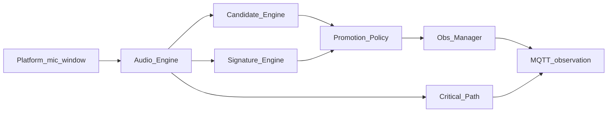

# dBmap — Module Runtime / Workflow Engine Architecture and Test Coverage Inventory

**Branch:** `investigate/module-runtime-workflow-inventory`  
**Base:** Branch HEAD, local `main`, and the existing `origin/main` ref all resolved to `01496b243b0f0b4f95cf41698ebb9fa59724d290` (PR #61 merged).  
**Date:** 2026-11-21  
**Scope:** Architecture/test inventory. Option A Package 1 (gate expansion + doc hygiene) is implemented on this branch; **no AE/CE/OM/Critical runtime behavior changes.**

**Evidence classes used below:**

| Tag | Meaning |
| --- | --- |
| **[impl]** | Verified in current source |
| **[docs]** | Stated in ADR / architecture docs |
| **[stale-docs]** | Docs that contradict the current tree |
| **[infer]** | Reasonable architectural inference (not a hard source fact) |
| **[exec]** | Executed in this investigation |

---

## Executive recommendation

**Recommend Option A:** preserve the current architecture and strengthen contracts/tests. Do **not** introduce a general Module Runtime / Workflow Engine now.

ADR 0002 still correctly defers a general Platform Module Runtime / Workflow Engine. Candidate Engine already contains a **minimal, CE-local** static module runtime and workflow runner. The highest-value next step is regression protection: put the existing ungated host suites into the normal fast gate, and clean stale documentation that still claims AE/CE or Module Runtime are absent.

---

## 1. Verified architecture inventory

### Data-plane sketch (device wire) — **[impl]**

```text
Platform mic (I2S → measure_window → PCM/window pending job)
  → ae_device_poll          [sole take_window_job consumer]
  → L0/L1/L2 + ae_signature_build → ae_publish_signature
       ├─ ce_on_signature → ce_manager_ingest → ce_workflow_run(ce.track)
       ├─ sig_engine_on_ae_signature → Signature Engine match snapshots
       └─ critical_on_ae_signature → ear_critical_on_signature (when enabled)
  Candidate state + classification evidence → ear_promotion_policy → ce_promote
  → ear_obs_manager via promotion events (normal Observation capacity 2)
```

Product wiring lives in [ear_observation.c](../../firmware/products/dbmap/ear/ear_observation/ear_observation.c#L3100). It binds SE and CE to AE, optionally attaches Critical, and polls Policy before the Observation Manager. Host evidence below uses repository C sources and synthetic inputs. No project or live device data was queried.



---

### 1.1 Sensor Platform

| Item | Detail |
| --- | --- |
| **Files** | `firmware/platform/mic/` (`ear_mic.c`, `sp_mic_window_job.c`, `ear_mic_channel_api.c`, `i2s_stereo.c`, …); `firmware/platform/audio/` (`sp_acoustic_l0/l1/l2`, `sp_audio_analyze`); `firmware/platform/observation/` (episode registry, seq, gates) |
| **APIs** | `sp_mic_take_window_job`, `sp_mic_take_pcm_job`, `sp_mic_pcm_pending_overwrite`, `sp_mic_get_channel`, `sp_episode_registry_*`, `sp_obs_seq_*` |
| **Owns** | I2S/DMA, measure windows, PCM banks, channel metrics, health audio seeds, Observation *infrastructure* (slots/seq) |
| **Does not own** | AE features, CE candidates, product Observation policy, classifiers |
| **Implemented** | Multi-mic coherent window jobs; single pending PCM/window job with overwrite counter; L0–L2 DSP math |
| **Deferred / planned** | Versioned multi-contract catalog, multi-subscriber Platform bus, and Engine registry **[docs]** [ADR 0002](../adr/0002-audio-and-candidate-engine.md) / [companion §0](audio-and-candidate-engine.md) |
| **Tests (gated)** | `test_sp_mic_window_job`, `test_ear_mic_channel_api`, `test_stereo_unpack`, `test_background_rms`, acoustic L0–L2/golden/multimic |

**PCM single-consumer — [impl]+[docs]:** `ae_device.h` states AE is the sole consumer of `sp_mic_take_window_job` when enabled. Overwrite of a still-pending job increments `s_pcm_pending_overwrite`; AE marks the next signature `AE_QUALITY_GAP`. Signature delivery fans out synchronously in `ae_publish_signature` after the history push. Consumers have the published signature contract. A future consumer needing phase-preserving samples needs a separately specified aligned PCM lifetime, channel/time metadata, and per-consumer loss semantics. Fan-out / Spatial / DOA / TDOA are explicitly out of scope for this investigation and for AE/CE v1.

---

### 1.2 Audio Engine

| Item | Detail |
| --- | --- |
| **Files** | `…/audio_engine/` (`ae_engine`, `ae_signature`, `ae_history`, `ae_time`, `ae_gap`, `ae_align`, `ae_stereo`); `…/ae_runtime/ae_device.c`, `ae_sig_capture.c` |
| **APIs** | `ae_start`, `ae_publish_signature`, `ae_add_signature_listener`, `ae_remove_signature_listener`, `ae_signature_build`, `ae_signature_usable_for_tracking`, `ae_device_start/poll` |
| **Owns** | Signature schema, quality/gap at publish, history (`AE_HISTORY_CAPACITY` 32), listener fan-out (≤4) |
| **Does not own** | I2S, Candidates, Observations, Signature Engine definitions |
| **Implemented** | Full publish/history/listener path + device intake **[impl]** |
| **Deferred** | Dedicated AE FreeRTOS task as permanent Platform contract; Platform contract catalog **[docs]** |
| **Stale docs** | Some banners still read as “design only / not implemented” while the tree is live **[stale-docs]** |
| **Tests (gated)** | align, stereo, signature_history, time_contract, window_job_align, stereo_integrity, features_from_pcm, window_validity, m4_lifecycle_gap, ae_sig_capture |

---

### 1.3 Signature Engine

| Item | Detail |
| --- | --- |
| **Files** | `…/signature_engine/sig_engine.c`, `ear_siren_se_public.c`; profiles in `…/acoustic_profile/` |
| **APIs** | `sig_engine_start/stop`, `sig_engine_on_ae_signature`, `sig_engine_copy_result`, `sig_engine_get_primary_distance_match`, `sig_engine_allows_promote`, AS-002 copy APIs |
| **Owns** | Per-definition match state, multi-hit snapshot, AS-001/AS-002 publication under locks |
| **Does not own** | PCM, CE slot FSM, Observation START |
| **Boundary note** | Product classifiers (SE + Promotion Policy) run **beside** CE’s `as.profile` module; they are not the same path **[impl]** |
| **Constraint** | AS-001 / AS-002 must not be modified by the next package without separate approval |
| **Tests (gated)** | `test_sig_engine`, `test_sig_engine_ce_primary`, `test_as_profile_as001`, `test_as001_as002_compare`, `test_ear_siren_se_public`, `test_ear_cls_progressive`; `test_ear_cls_as001` needs IDF cJSON |

---

### 1.4 Candidate Engine

| Item | Detail |
| --- | --- |
| **Files** | `ce_engine`, `ce_manager`, `ce_module`, `ce_module_profile`, `ce_workflow`, `ce_decision`, `ce_types` |
| **Owns** | Slot mutations (`ce_manager_*`); storage on `ce_engine_t`; static module registration/execute accounting |
| **Does not own** | Observations, PCM, Critical Path |
| **Capacity** | `CE_MAX_CANDIDATES` = 8; modules `CE_MAX_MODULES` = 6 |
| **Promotion** | The default workflow yields KEEP/SKIP/ERROR. Explicit actions delegate to `ce_manager_promote` and `ce_manager_reject`. The façade also has a custom workflow hook and an `apply_decision` path for PROMOTE/REJECT. Product initialization uses the default workflow **[impl]**. |

**CE-local module / workflow (already implemented — not a Platform product):**

| Layer | Header claim | Behavior |
| --- | --- | --- |
| Module runtime | `ce_module.h`: “Static module runtime. No dynamic loader…” | `ce_runtime_register/start/execute`; built-ins `ce.evidence`, `as.profile` |
| Workflow | `ce_workflow.h`: “Not a general workflow product.” | Static step tables; `ce.track` → MODULE → FUSE → KEEP/SKIP/ERROR |
| Decision | `ce_decision.h` | `ce_decision_fuse_track` never returns PROMOTE/REJECT |

**Planned / deferred for CE:** soft-association / split-merge; optional Stage 4 workflow-driven PROMOTE; **Full Module Runtime product** and **General Workflow Engine** left alone until later (`candidate-engine-proposal.md`).

**Tests:** `ce_lifecycle`, `ce_identity` **gated**; `test_ce_architecture` **ungated but passes** when compiled with gate include paths **[exec]**.

---

### 1.5 Observation Manager

| Item | Detail |
| --- | --- |
| **Files** | `ear_obs_manager.c/h`, `ear_promotion_policy.c`, `ce_promotion_bridge.c` (legacy), publish/`observation_payload` |
| **Owns** | Normal Obs create/bind/end (capacity 2); promote snapshots; END authority including activity END while CE live; detached END watchdog (Stage 3) |
| **Does not own** | CE slot FSM; Critical Path binding (sibling) |
| **Implemented** | Promotion-gated Obs; S2 live evidence ownership; S3 detached watchdog **[impl]** + gated tests |
| **Tests (gated)** | `test_ear_obs_manager` (large S2/S3/P2 suite) |

CE EXIT detaches only. The manager owns terminal publication. Its detached watchdog runs on the manager clock, can be cancelled by valid reattachment, and excludes AS-002, which has its own signature-absence END policy. See [ear_obs_manager.c](../../firmware/products/dbmap/ear/ear_observation/ear_obs_manager.c), [ADR 0003](../adr/0003-critical-observation-path-and-shared-evidence.md) and `test_s3_*` in `test_ear_obs_manager.c`.

---

### 1.6 Critical Path

| Item | Detail |
| --- | --- |
| **Files** | `ear_critical_path.c/h`; ADR 0003; `CRITICAL_PATH.md` |
| **APIs** | `ear_critical_init`, `on_signature`, `poll`, `force_start`, `inject_evidence`, `close_for_ota`, `force_end` |
| **Owns** | Capacity-1 Critical binding; frozen evidence; START/PERIODIC/END with `origin=critical_path` |
| **Independence from CE** | Header + ADR: no CE create/promote/EXIT required; must START while both normal slots busy; must not consume registry slots **[impl]+[docs]** |
| **Auto-detect** | Production acoustic START is disabled. A separately configured laboratory impulse trigger exists alongside force-start and evidence injection **[impl]** (`lab_impulse_should_start`, `ear_critical_on_signature`). |
| **Tests** | `test_ear_critical_path`, `test_ear_critical_integration` — **not in fast gate**; both **PASS** in this investigation **[exec]** |

---

### 1.7 Existing module / workflow mechanisms vs Platform product

| Mechanism | Status | Notes |
| --- | --- | --- |
| CE static module runtime | **[impl]** | Sufficient for current CE annotation modules |
| CE minimal workflow + fuse | **[impl]** | Keep/Skip/Error only on default track |
| Product SE + Promotion Policy | **[impl]** | Parallel to CE modules; the production normal path uses Policy for promotion |
| Platform Module Runtime / Engine registry / contract bus | **Absent / deferred** **[docs]** ADR 0002 §3, companion §0.3–0.4 |
| General Workflow Engine | **Deferred** **[docs]** | Proposal: “minimal static tables / not a general engine” |

**ADR stance (must respect unless overturned with evidence):**

> Observation publishing, Module Runtime, Workflow Engine, Decision/Fusion, … and full Engine Runtime remain **later** consumers or peers — not owners of acquisition. AE/CE v1 must keep interfaces migratable … without implementing that shared foundation now.  
> — `docs/adr/0002-audio-and-candidate-engine.md` Decision §3

---

## 2. Need for a Module Runtime / Workflow Engine (answers)

1. **What concrete problem would a general Module Runtime solve that current code cannot?**  
   None demonstrated for the current product path. Classifiers already attach as AE listeners (SE) or CE static modules (`as.profile`). Promotion is explicit via Policy + `ce_promote`. A Platform-wide runtime would mainly prepare for unbuilt peers (Monitor Engine, Spatial consumers), not fix a failing current contract.

2. **Which module contracts already exist?**  
   `ce_module_desc_t` / `ce_runtime_*`, `ce_workflow_t` / `ce_workflow_run`, `ce_decision_*`, AE listener callbacks, SE listener + query APIs, Promotion Policy / `ce_promote` / OM ENTER/EXIT.

3. **Is lifecycle / dispatch / state duplicated?**  
   CE owns candidate lifecycle, OM owns normal Observation lifecycle, Critical owns its independent Observation lifecycle, and SE owns match state. Normal and Critical publishers share emission concepts and some infrastructure, with distinct admission, binding, and termination rules. AE listener dispatch and CE module dispatch serve different inputs. The source exposes no demonstrated need for common lifecycle or scheduling machinery.

4. **Could clearer contracts + stronger tests suffice?**  
   Yes. That is Option A. The richest module/workflow suite (`test_ce_architecture`) and Critical Path suites already exist but are outside CI.

5. **How should Critical Path remain independent of Candidate Engine?**  
   Keep Critical as an AE listener peer that never calls `ce_promote` / CE ingest for its own START. Preserve capacity-1 EAR-owned binding and registry-slot independence. Gate `test_ear_critical_*` so this cannot regress silently.

6. **Boundaries for future Spatial / DOA / TDOA?**  
   Preserve: Platform owns acquisition; AE owns signatures without hard-wiring Spatial into CE; coherent `window_seq` / `measured_at_us` on window jobs; AE façade not owning PCM take (`ae_engine.h` / §0.9). Do **not** implement Spatial now.

7. **Single-consumer PCM queue implications?**  
   `sp_mic_take_pcm_job` and `sp_mic_take_window_job` drain the same pending slot. A successful take removes that delivery, so an additional taker could starve AE without increasing the overwrite counter. Sequence discontinuity can surface as a GAP. Future independent consumers need Platform fan-out (deferred). Until then, new analysis peers should consume **AE signatures** (or a future Platform multi-subscriber contract), not steal the PCM job.

**ADR change?** Not recommended. No technical evidence justifies overturning the deferral of a *general* Platform Module / Workflow Engine. The CE-local minimal runtime already covers today’s need.

---

## 3. Automated test inventory

### 3.1 Execution results (this investigation) — **[exec]**

| Command / suite | Result | Notes |
| --- | --- | --- |
| `./firmware/scripts/run_firmware_fast_gate.sh --host-only` | **PASS** | `pass=44 fail=0 skip=1 duration_s=32` |
| Default environment skip | `host/ear_cls_as001` | Gate could not resolve cJSON without `IDF_PATH`. |
| `IDF_PATH=/home/christer/esp/esp-idf ./firmware/scripts/run_firmware_fast_gate.sh --host-only` | **PASS** | `pass=45 fail=0 skip=0 duration_s=34`. Host compiler used the local ESP-IDF cJSON source. |
| `test_ce_architecture` (manual `cc`, gate include paths) | **PASS** | File-header `cc` recipe is **stale** (missing platform/SE includes) |
| `test_ear_critical_path` (manual) | **PASS** | Same: needs platform audio includes |
| `test_ear_critical_integration` (manual) | **PASS** | |
| `test_ce_promotion_bridge` (manual) | **PASS** | Legacy bridge; still useful regression |
| `test_observation_payload` (manual cJSON host compile below) | **PASS** | Ungated standalone JSON suite. |
| Full gate with IDF modularity | **Not executed** | No claim; `--host-only` only |
| Hardware / device soak / Hub MQTT round-trip | **Not executed** | Explicitly out of scope for this investigation |
| Firmware build / OTA | **Not performed** | Per constraints |

**Important:** existence of a test file ≠ verification. Behaviors below marked **Verified** were either in the passing gated suite or in the manually executed ungated binaries above. Both host gate runs exited zero and emitted a compiler warning about potential `strncpy` truncation in `ear_mic_channel_api.c:65`. The five standalone suites compiled with `-Werror` and exited zero.

Run the following with Bash from the repository root to reproduce all five standalone runs.

```bash
#!/usr/bin/env bash
set -eu
ear=firmware/products/dbmap/ear
platform=firmware/platform
ae=$ear/audio_engine
ce=$ear/candidate_engine
ap=$ear/acoustic_profile
se=$ear/signature_engine
obs=$ear/ear_observation
registry=$platform/observation/episode_registry.c
inc=()
for component in "$ae" "$ce" "$ap" "$se" "$obs" "$ear/ear_acoustic" \
    "$platform"/{audio,mic,node_common,observation}; do
    inc+=("-I$component/include")
done
core=("$ae"/ae_{signature,history,engine,time}.c
      "$ce"/ce_{decision,module,module_profile,workflow,manager,engine}.c
      "$ap"/as_profile_{as001,registry,match}.c
      "$se"/{sig_engine,ear_siren_se_public}.c)
build=$(mktemp -d /tmp/dbmap-inventory.XXXXXX)
trap 'rm -r "$build"' EXIT
run() {
    local name=$1
    shift
    cc -std=c11 -Wall -Wextra -Werror -O2 "${inc[@]}" "$@" -lm -o "$build/$name"
    "$build/$name"
}
run ce_architecture "${core[@]}" "$registry" "$obs/ce_promotion_bridge.c" \
    "$ce/test_host/test_ce_architecture.c"
run ear_critical_path "$ae/ae_signature.c" "$registry" "$obs/ear_critical_path.c" \
    "$obs/test_host/test_ear_critical_path.c"
run ear_critical_integration "${core[@]}" "$registry" \
    "$obs"/ear_{obs_manager,promotion_policy,cls_progressive,cls_as001,critical_path,obs_ota_cleanup}.c \
    "$obs/test_host/test_ear_critical_integration.c"
run ce_promotion_bridge "${core[@]}" "$registry" "$obs/ce_promotion_bridge.c" \
    "$obs/test_host/test_ce_promotion_bridge.c"
json=/home/christer/esp/esp-idf/components/json/cJSON
run observation_payload "-I$json" "$json/cJSON.c" "$obs"/{observation_payload,ear_cls_as001}.c \
    "$obs/test_host/test_observation_payload.c"
```

### 3.2 Coverage table

| Area | Existing tests | Verified behavior | Coverage gaps | Recommendation |
| --- | --- | --- | --- | --- |
| Platform PCM windows / channels / seq | Gated mic + AE window/align/time/validity | Coherent window jobs; mono/pair; stale/newer reject; feature INVALID/GAP contracts | Live I2S DMA / wall-clock `WINDOW_MS`; physical L/R DIN | Keep gated; HW remains lab docs |
| Audio Engine | Gated AE suite + m4 gap | History, listeners, gap/overwrite→GAP, usable-for-tracking | Dedicated AE task; HW timing | Keep gated |
| Signature Engine AS-001/002 | Gated SE + profile + siren | Match/GAP/INVALID; primary vs CE; promote gates for AS-002 | Acoustic replay and thresholds on device; `ear_cls_as001` passed with local cJSON | Preserve; do not change AS matchers |
| CE multi-candidate | Gated `ce_identity` / `ce_lifecycle`; ungated architecture | Two sources; hysteresis; coast; rematch; capacity paths (architecture) | Architecture suite not in CI; Stage 5 HW multi-candidate | **Gate `test_ce_architecture`** |
| Promote → OM | Gated `ear_obs_manager` (+ ungated bridge) | Reserve/ENTER/EXIT; capacity; policy P2; end-once | Bridge ungated; HW dual-obs | Gate architecture; keep OM; leave bridge-only gating for a separate decision |
| Live evidence / gens / GAP / seq | Gated OM S2 + AE/CE gap | Owned copies; stale gen drop; GAP/INVALID reject; OoO seq | Full AE→MQTT jitter | Preserve OM S2 |
| START/PERIODIC/END + detached watchdog | Gated OM S3 | Detach-only EXIT; watchdog ends; AS-002 excluded; reattach cancel | Activity relative-end experiments ungated | Preserve S3; leave experiments out of gate |
| Critical Path vs CE | Ungated critical + integration | Force start w/o registry; START/PERIODIC/END; both normal slots busy; OTA cleanup; production auto-detect stays off; lab impulse START is separately tested | **Not in CI** | **Gate both Critical suites** |
| Module / workflow contracts | Mostly ungated `test_ce_architecture`; partial gated (`as_profile` no-promote, listener independence) | Runtime register/execute; workflow KEEP/SKIP/ERROR; fuse ignores score; promote only via explicit API | Default-track never-PROMOTE not CI-enforced | **Gate architecture suite** |
| Payload / MQTT JSON | Ungated `test_observation_payload`, conditionally gated `ear_cls_as001` | Both passed with local cJSON | Live MQTT delivery and Hub ingest are outside these tests | Preserve JSON coverage; consider gating the payload suite separately |

### 3.3 Host integration gaps

- **PCM and AE intake.** Host tests exercise coherent snapshots, synthetic timing/sequence and GAP rules. They do not drive the real capture producer and `ae_device_poll` together. A future intake change needs a fake producer through the public job interface covering empty poll, replacement before take, skipped sequence, and the first valid window after recovery. Physical channel order, DMA behavior, and capture-to-poll timing need an EAR.
- **Full product wiring.** `test_ae_sig_module_independence.c` exercises shared AE listeners and `test_ear_critical_integration.c` uses production CE, normal Observation Manager, Critical Path, registry, and cleanup logic with host publishers. Together they leave the production registration and poll order in `ear_observation.c` outside the host boundary. If touching it, exercise the actual shared wiring with fake clocks/publishers: interleave two normal bindings and one Critical binding, exercise listener exhaustion and restart, and check origin, identity, one END per binding, and no registry or listener leak. This is deterministic interleaving under the single-task contract. Device scheduling and MQTT delivery require separate verification.
- **Combined generation, capacity, and continuity.** OM tests already cover stale generation, rejected GAP/INVALID, non-increasing sequence, reused watchdog bindings, and queue-full recovery separately. A future binding or queue change should combine them: release and reuse a normal slot under capacity pressure, send late EXIT/live evidence for the old generation and duplicate/out-of-order input for the new binding, and verify the new Observation keeps its identity, evidence, capacity and END deadline. Keep the existing AS-002 watchdog exclusion and AS-001 stale-across-GAP checks.
- **Local runtime rollback.** The architecture suite covers registration capacity, duplicate IDs, failed registration init, reverse shutdown, and workflow failure paths. If startup or scheduling changes, add a direct `ce_runtime_start` partial-init rollback and restart test with a failing second initializer and shutdown counters. If workflow selection changes, assert policy-denied custom decisions cannot open a product Observation.

### 3.4 Regression risks (if gate stays as-is)

- **CE module/workflow contract drift** — richest assertions live only in ungated `test_ce_architecture`.
- **Critical Path independence** — no CI signal if Critical starts requiring CE or consuming registry slots.
- **Stale header compile recipes** — operators following file-header `cc` lines fail; gate paths succeed.
- **AS-001/AS-002 / OM** — currently well gated; risk rises if future work expands CE workflow into promote without updating OM tests.
- **Hardware Stage 5** — multi-candidate device verification still outstanding per `candidate-engine-proposal.md`; host PASS ≠ device PASS.

---

## 4. Options comparison

### Option A — Preserve architecture; strengthen contracts/tests *(recommended)*

| | |
| --- | --- |
| **Solves** | Silent regression of CE module/workflow contracts and Critical↔CE independence; stale docs that confuse “minimal CE runtime” with “Platform Module Runtime” |
| **Affected** | Primarily `firmware/scripts/run_firmware_fast_gate.sh`; test-file header recipes; possibly short notes in `audio-and-candidate-engine.md` / `sensor-platform-architecture.md` |
| **Risks / complexity** | Low. No runtime behavior change if only gating existing suites |
| **Tests** | Add `ce_architecture`, `ear_critical_path`, `ear_critical_integration` to host gate; keep all existing gated AE/CE/OM/SE tests |
| **Must remain unchanged** | AS-001/AS-002; CE/OM semantics; Critical auto-detect-off; MQTT schema; no Spatial/PCM fan-out; ADR 0002 deferral |

### Option B — Limited Module Runtime / Workflow capability

| | |
| --- | --- |
| **Solves** | Could serve a module with a demonstrated need for an independent bounded cadence or resource budget. CE already exposes `ce_module_register` and `ce_engine_set_workflow` for static use. |
| **Affected** | `ce_module` / `ce_workflow` / product registration in `ce_engine` / possibly Policy |
| **Risks** | Easy scope creep into “general” runtime; promote-from-workflow can bypass Policy deny-by-default |
| **Tests** | Test ordering, backlog cap, stop/restart and initialization rollback for any added scheduling. Preserve default KEEP/SKIP/ERROR and test denial at the product promotion boundary. |
| **Unchanged** | Platform acquisition; Critical independence; AS profiles unless separately approved |

**Not recommended now:** no demonstrated plug-in requirement beyond static `ce.evidence` / `as.profile`.

### Option C — General Module Runtime / Workflow Engine

| | |
| --- | --- |
| **Solves** | Could coordinate multiple independently scheduled engines with defined subscription, resource, and lifecycle requirements. No current product requirement demonstrates that need. |
| **Affected** | Platform + all Engines; large ADR set |
| **Risks** | High complexity; premature abstraction; conflicts with ADR 0002; slows AE/CE hardening |
| **Tests** | Test subscription isolation, independent backpressure, timestamp continuity, resource limits, startup rollback, and stop/restart. Run migrated CE, OM, SE and Critical regression suites. |
| **Unchanged** | Preserve Platform acquisition ownership, profile outputs, CE identity, OM admission and END authority, Critical independence, and MQTT payloads. |

**Reject for this stage.** Would overturn ADR 0002 without a concrete consumer that the current CE-local runtime cannot serve.

---

## 5. Recommended next implementation package (bounded)

**Name:** Gate CE architecture + Critical Path host contracts (Option A, package 1)  
**Approval required before any code change.** This inventory does **not** implement it.

### Scope

1. Extend [`firmware/scripts/run_firmware_fast_gate.sh`](../../firmware/scripts/run_firmware_fast_gate.sh) to compile/run:
   - `candidate_engine/test_host/test_ce_architecture.c`
   - `ear_observation/test_host/test_ear_critical_path.c`
   - `ear_observation/test_host/test_ear_critical_integration.c`
   - Keep the bridge-only and standalone payload suites outside this first gate change. The architecture suite itself still links the bridge for an explicit-promotion fixture.
2. Fix stale `cc` recipes in those test file headers to match gate include paths (so manual runs match CI).
3. In `docs/architecture/audio-and-candidate-engine.md` and `docs/sensor-platform-architecture.md`, update the stale implementation status and clarify that **CE-local** static module/workflow ≠ deferred **Platform** Module Runtime (ADR 0002).

### Explicit non-goals

- No AS-001/AS-002 changes  
- No CE/OM/Critical *behavior* changes  
- No general Module Runtime / Workflow Engine  
- No Spatial / DOA / TDOA / PCM fan-out  
- No MQTT schema changes  
- No firmware build / OTA as part of the package (host gate only)

### Behavioral changes

**None expected.** Failures would mean the gate previously missed a real break, not a product change.

### Test plan (acceptance)

| Criterion | How to verify |
| --- | --- |
| Gate includes new suites | Each of the three names appears as PASS in the normal CI host-only entry point. A failed compile or assertion fails the gate. |
| Host-only gate green | `./firmware/scripts/run_firmware_fast_gate.sh --host-only` → PASS including new names |
| Negative / preserved | Existing OM S2/S3, CE lifecycle/identity, SE, AS profile tests still PASS |
| Critical independence | Gated critical suites assert no registry slot consume + start with both normal slots busy |
| Module/workflow | Gated architecture asserts default track does not PROMOTE; modules cannot mutate candidates |
| Manual recipes | Each documented command compiles and executes from the repository root. |

### Later hardware (deferred, not in package 1)

- Stage 5 multi-candidate device verification (`candidate-engine-proposal.md`)  
- Critical latency distributions (ADR 0003 measurement table)  
- Stereo DIN physical integrity / AS-001 bench docs  

---

## 6. Open decisions (approval before implementation)

1. **Approve Option A package 1** (gate ungated suites + doc hygiene) as the next PR?  
2. Decide separately whether to gate the legacy bridge-only and cJSON-dependent payload suites.  
3. Any appetite for **Stage 4** (workflow-driven PROMOTE) later? Default recommendation: **no** — retain Policy as the normal product admission path.  
4. When (if ever) to schedule Platform PCM multi-subscriber work — only with a real second PCM consumer design, not for symmetry.  
5. Hardware Stage 5 lab time — separate from package 1.

---

## Clear recommendation

| Question | Answer |
| --- | --- |
| **What next?** | Option A package 1: put CE architecture + Critical Path host tests into the fast gate; fix stale compile recipes; clarify docs. |
| **Why now?** | Those suites already exist and pass, but CI does not run them — highest regression leverage for AS-001/002-adjacent CE/OM and Critical independence **without** inventing a new engine. |
| **Which tests add/preserve?** | **Add to gate:** `test_ce_architecture`, `test_ear_critical_path`, `test_ear_critical_integration`. **Preserve:** entire current host-only AE/CE/OM/SE gated set. |
| **Defer** | General Module Runtime / Workflow Engine (ADR 0002); Spatial/DOA/TDOA; PCM fan-out; Stage 4 workflow PROMOTE; CE/OM behavior changes; AS-001/AS-002 edits; MQTT schema; device Stage 5 (separate). |

**Package 1 status:** Approved and implemented on this branch (fast-gate membership + stale-doc/recipe fixes). Further packages still require separate approval.
