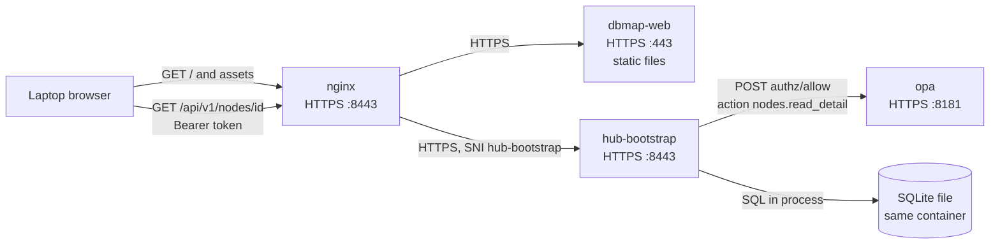
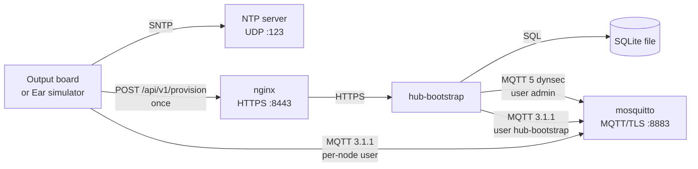
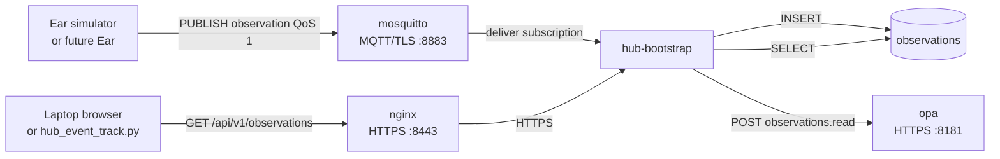
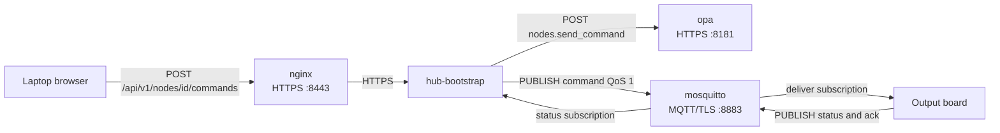

# Connectivity map

Current LOCAL_MEDIUM path from a laptop, an Output board, and an Ear client into the Compose stack. An arrow runs from the client that opens the connection to the server that accepts it. The port is the server's listening port.

The browser page and the Hub API are different containers. Nginx is the only HTTPS listener on the LAN. It forwards pages to `dbmap-web` and `/api` to `hub-bootstrap`. SQLite is a file inside `hub-bootstrap` (`/data/bootstrap.db` on the `bootstrap-data` volume). There is no database port.

OPA is consulted on every protected API call, including opening one device. The Policy engine details button adds a separate health request. Database details stay inside `hub-bootstrap`. Output boards and the Ear simulator publish MQTT to Mosquitto; `hub-bootstrap` writes SQLite from its own subscription. That write does not pass through Nginx or OPA.

Message fields are in the [protocol reference](./protocol.md). Authorization actions are in [authorization](./authorization.md). The Hub HTTPS routes are in [hub-api.openapi.yaml](./hub-api.openapi.yaml).

## Listeners

| Process | Who can connect | Protocol | Port | Notes |
| --- | --- | --- | --- | --- |
| `nginx` | Laptop, Output, Ear simulator, CLI | HTTPS, TLS 1.2 and 1.3 | `${DBMAP_LAN_IP}:${DBMAP_HTTPS_PORT:-8443}` | Only published HTTPS port. Verifies each upstream certificate. |
| `dbmap-web` | `nginx` on the Compose network | HTTPS | `443` | Static files. No API, database, or MQTT client. |
| `hub-bootstrap` | `nginx` on the Compose network | HTTPS | `8443` | API, SQLite, MQTT subscriber, command publisher, broker-user admin. |
| `opa` | `hub-bootstrap` on `opa-private` | HTTPS | `8181` | No host port. Decision URL `POST /v1/data/dbmap/authz/allow`. |
| `mosquitto` | Devices, simulator, `hub-bootstrap`, and the LAN | MQTT 3.1.1 over TLS | `${DBMAP_LAN_IP}:8883` | Username and password. Server certificate only; clients do not present a certificate. |
| `firmware-builder` | `nginx` on `firmware-private` | HTTPS | `8443` | Optional `firmware-build` profile. No host port. |
| SQLite | The `hub-bootstrap` process | File | none | `sqlite:////data/bootstrap.db` |
| Board USB serial | The laptop browser | Web Serial | 115200 baud | Identity, flash, and NVS provisioning. The Hub is not on this path. |
| NTP server | The Output board | SNTP, UDP | `123` | `DBMAP_NTP_SERVER`, default `se.pool.ntp.org`. Set at firmware build time. |

`opa-private` and `firmware-private` are internal Compose networks. OPA shares a network only with `hub-bootstrap`. The firmware builder shares `firmware-private` with Nginx and with `hub-bootstrap`, which uses it only for the builder health check.

## Laptop opens one device

An administrator opens the UI, then one device. The viewer path is the same shape with `GET /api/v1/devices` and the `devices.list_summary` action. Viewer tokens do not receive `GET /api/v1/nodes/{node_id}`.

| Step | Client | Server | What crosses |
| --- | --- | --- | --- |
| 1 | Browser | `nginx:8443` | `GET /` and static assets. |
| 2 | `nginx` | `dbmap-web:443` | The same page request. The UI holds the bearer token in memory and calls the API itself. |
| 3 | Browser | `nginx:8443` | `GET /api/v1/nodes/{node_id}` with `Authorization: Bearer`. |
| 4 | `nginx` | `hub-bootstrap:8443` | The same API request. |
| 5 | `hub-bootstrap` | local token check | Compares the bearer token with the admin or viewer secret. This step does not call OPA. |
| 6 | `hub-bootstrap` | `opa:8181` | `POST /v1/data/dbmap/authz/allow`. Missing or non-boolean decisions fail the request with HTTP 503. |
| 7 | `hub-bootstrap` | SQLite file | Reads the node, reported state, installation, and ownership. Online means a keepalive arrived within the last 90 seconds. |

Hub overview **Details** uses the same browser → Nginx → `hub-bootstrap` → OPA → SQLite path, because `GET /api/v1/hub/components/{component}/details` is a protected API call. The extra hop depends on the component:

| Details button | After the OPA decision |
| --- | --- |
| Hub API | Returns listener text. No further connection. |
| Database | In-process SQLite version, file size, and row counts. |
| Policy engine | Additional `GET https://opa:8181/health?plugins=true`. |
| MQTT broker | Returns `$SYS` metrics already collected on the Hub's existing MQTT session. No new connection. |
| Nginx | `GET /health` through the Compose name `nginx`, with TLS server name `hub.local`. |
| Web | `GET https://dbmap-web/health`, a short response. The probe reads that response to completion. |
| Firmware builder | `GET https://firmware-builder:8443/health`. No answer means the optional profile is not running. |

An administrator can also open **Logs** on a container component. `hub-bootstrap` reads the latest 10 lines from the local Docker engine for that Compose service. The database is not a container, so it has no log button. Viewer tokens can read component status and details, and cannot read container logs.

CLI tools on the laptop (`curl`, `scripts/hub_summary.py`, `scripts/hub_admin.py`, `scripts/hub_event_track.py`) are the same HTTPS client as the browser: they call Nginx and stop there. They do not open MQTT.

## USB stays on the laptop

Registration, ESP Web Tools flashing, NVS provisioning, and ESPConnect use the browser's Web Serial port at 115200 baud. The cable runs from the laptop to the board. Nginx only serves the static flasher and ESPConnect files. The bearer token is not sent down the serial port. Wi-Fi settings and the one-time bootstrap token go to the board's NVS; MQTT credentials are not part of that USB write.

## Output and Ear call home

ESP-Output is the physical client. The Ear client that runs in this repository is `simulator/ear` on the laptop. A later Ear image would use the same two hops through `firmware/components/node_common`: one HTTPS provision, then MQTT. Topic roots differ: `esp-output/local/<node-id>/` and `esp-ear/local/<node-id>/`.

Provisioning happens once, after Wi-Fi, and again only if a replacement bootstrap token is issued.

| Step | Client | Server | What crosses |
| --- | --- | --- | --- |
| Clock | Output | NTP, UDP 123 | SNTP. Independent of the Hub. Command expiry logs use this clock. |
| Provision | Device or simulator | `nginx:8443` → `hub-bootstrap:8443` | `POST /api/v1/provision` with the one-time bootstrap token. OPA is not called. |
| Credential | `hub-bootstrap` | `mosquitto:8883` | Short-lived MQTT 5 session as `admin`, publishing `$CONTROL/dynamic-security/v1`, to create that node's username and topic ACL. The same admin session runs at Hub startup. |
| Store | `hub-bootstrap` | SQLite file | Consumes the bootstrap token and stores the MQTT username. The password is returned once and is not kept in SQLite. |
| Session | Device or simulator | `mosquitto:8883` | MQTT 3.1.1, TLS, keepalive 30 seconds, username = lowercase node id. |

Steady messages after that session is up:

| Publisher | Topic suffix | QoS | Subscriber | Where it is stored |
| --- | --- | --- | --- | --- |
| Output and Ear | `hello` | 1 | `hub-bootstrap` | `reported_state` |
| Output and Ear | `keepalive`, `health` | 0 | `hub-bootstrap` | `reported_state`. Keepalive refreshes online/offline. |
| Output | `status` | 1 published; Hub subscribes at 0 | `hub-bootstrap` | `reported_state` |
| Output | `ack` | 1 | none in the Hub | Broker delivers it only to a client that subscribed. The Hub listener does not. |
| Ear | `observation` | 1 | `hub-bootstrap` | `observations`, after validation. Retained messages and duplicate observation IDs are rejected. |
| `hub-bootstrap` | `command` | 1 | Output | Not stored as a command log. The board drives GPIO and publishes `ack` and `status`. |
| either side | `config` | — | ACL allows it | No sender implements it. |

`hub-bootstrap` also subscribes to Mosquitto `$SYS` counters on that same long-lived session (client id `hub-bootstrap`). Broker limits on this listener are a 4096-byte message cap and 100 connections.

## Observation, write and read

The write path and the read path are different clients of the same SQLite table.

Ingest checks that the topic is `esp-ear/local/<node-id>/observation`, the payload is protocol version 1, and the node is an active Ear. It does not call OPA. The Observations tab and `scripts/hub_event_track.py` read the stored rows through the API. The script prints pairwise Ear site distances from installation rows; it does not subscribe to MQTT and it does not create events or tracks.

## Output command

The command is published on the Hub's existing MQTT session. `status` comes back into `reported_state`. `ack` is published by the firmware and is not ingested.

## Optional firmware builder

With the `firmware-build` profile, `GET/POST /api/v1/firmware/targets` and `/api/v1/firmware/builds` go browser → `nginx:8443` → `firmware-builder:8443`. The builder checks the admin bearer token itself. It has no route to OPA, SQLite, or Mosquitto. Catalog list, upload, promote, and download stay on `hub-bootstrap` (`/api/v1/firmware/catalog...`), with ZIP bytes on the `firmware-catalog` volume and rows in SQLite. Those catalog calls follow the normal API path, including OPA.

## Functions that share a process

These already run as their own container: Nginx (TLS and routing), `dbmap-web` (static UI), OPA (allow/deny), Mosquitto (sessions and ACLs), and the optional firmware builder (compilation).

`hub-bootstrap` is one process and one SQLite file doing the rest:

| Function | Trigger | Leaves the process? |
| --- | --- | --- |
| Bearer-token check | Every API call except provision | No |
| Policy client | Every protected API call | Yes, HTTPS to OPA |
| Identity, ownership, users, groups, desired and reported state, installation | API reads and writes; MQTT updates reported state | SQLite file only |
| Observation ingest | Ear MQTT `observation` | SQLite file only |
| Observation read | `GET /api/v1/observations` | OPA, then SQLite |
| Broker-user admin | Process start, and each `POST /api/v1/provision` | Yes, MQTT 5 to Mosquitto |
| Command publish | `POST /api/v1/nodes/{id}/commands` | OPA, then the existing MQTT session |
| Firmware catalog metadata and deployment-attempt audit | Catalog and Devices API | OPA, SQLite, and the catalog volume |
| Hub status counts | `GET /api/v1/hub/status` | OPA, then SQLite, the in-memory MQTT session flag, and short HTTPS checks of Nginx, Web, and the firmware builder |

The seam between "device data coming in" and "someone reading it" is already visible: ingest is MQTT → SQLite, and reading is HTTPS → OPA → SQLite. Both use the same process and the same file. Command publish uses that same MQTT session. USB, the static UI, policy decisions, the broker, and firmware compilation are already outside it.
