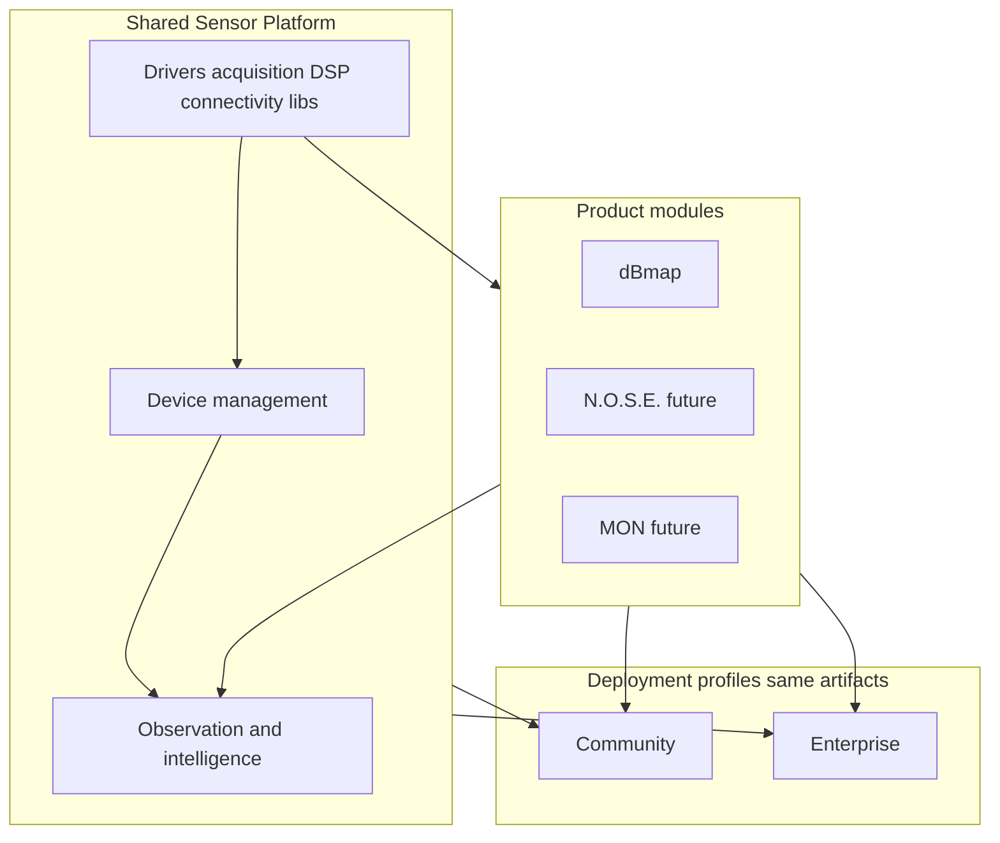
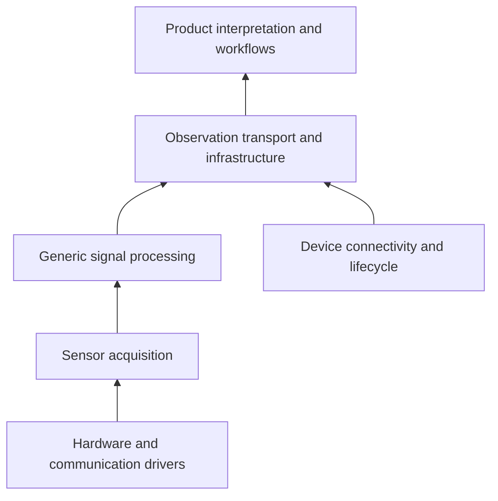

# Sensor Platform architecture

Long-term architectural reference for this repository.

**Normative decisions:** [ADR 0001](./adr/0001-sensor-platform-architecture.md).  
**This document** summarizes structure, terminology, ownership, and what is implemented versus planned. It does not claim that future capabilities already exist.

---

## 1. High-level architecture

**Implemented today (verified):** local Hub monolith (MQTT, HTTPS API, web UI, OPA), Ear/Output firmware sharing `node_common`, Observation protocol v1 ingest and persistence, admin/viewer bearer auth, optional Compose profiles (`analysis`, `firmware-build`).

**Not implemented:** N.O.S.E., MON/Modbus, Community sharing services, Enterprise tenancy, ordinary-user OIDC login, Hub-persisted Event/Track entities.

---

## 2. Terminology and ownership

### 2.1 Core terms

| Term | Definition | Ownership |
| --- | --- | --- |
| **Sensor Platform** | Shared codebase and versioned components for device lifecycle and observation infrastructure | Platform |
| **Product** | Domain application on the platform (dBmap, future N.O.S.E., MON) | Product team / module |
| **Deployment profile** | Community or Enterprise configuration of the **same** versioned artifacts | Ops / install config |
| **Device** | Registered node with Hub-scoped identity | Platform (device management) |
| **Observation** | One device report episode (identity + context + product measurement schemas) | Platform envelope; product schemas |
| **Track** | Continuity of a source/pattern on one device across Observation episodes | Platform concept; device may mint `track_id` |
| **Event** | Correlated multi-device/multi-track occurrence | Platform concept; **script-local today**, not Hub tables |

### 2.2 Observation identity (protocol v1)

| Field | Role today |
| --- | --- |
| `observation_id` | Report episode UUID (START/PERIODIC/END share one id) |
| `sequence_number` | Per-node MQTT dedup key with `node_id` |
| `track_id` | Optional continuity UUID; Hub accepts and stores; does not mint or manage tracks |
| `termination_reason` | Includes `natural`, `invalid_hold`, `ota_reboot`, and `report_rotation` |

`report_rotation` means the **Observation report episode** ended for reporting budget/interval reasons. Physical continuity is indicated by a stable `track_id`, not inferred from the reason alone.

### 2.3 Schema families

| Schema | Family | Status |
| --- | --- | --- |
| Observation envelope (`protocol_version`, `identity`, `context`, `spatial`, …) | **Platform** | Implemented |
| Acoustic `measurements` L0, `signature` L1, `dynamics` L2 | **dBmap** | Implemented (Ear + Hub) |
| `assessment` `ear_hyp_v1`, `evidence` `ear_ev_v1`, `debug` `ear_dbg_v1` | **dBmap** | Hub accepts; firmware emit not required for Hub compatibility |
| Future `nose_*` / `mon_*` schemas | Product-specific | Not defined |

The platform Observation envelope must eventually admit non-acoustic products **without** requiring L0/L1/L2. Until that pluggability work lands, current Ear payloads remain acoustic as deployed.

### 2.4 Responsibility matrix (target ownership)

| Concern | Platform | dBmap | N.O.S.E. / MON |
| --- | --- | --- | --- |
| Provision, OTA, MQTT health, node identity | Own | Use | Use |
| Observation ingest, persistence, generic APIs | Own | Publish product schemas | Publish product schemas |
| Track/Event correlation services | Own when built | Product scoring / UI | Product scoring / UI |
| Acoustic DSP (RMS, FFT, L0–L2) | Shared **libs** | Product use | Must not depend |
| VMA / aircraft / drone / explosion meaning | No | Own | No |
| Modbus / building infrastructure meaning | Driver libs when needed | No | MON owns |
| Community sharing / Enterprise tenants | Optional platform capabilities | Consume | Consume |

---

## 3. Sensor component categories

Dependency rule: **lower layers must not import product interpretation.**

| Category | May contain | Must not contain |
| --- | --- | --- |
| Drivers | I2S, UART/Modbus (when real), GPIO | Hypothesis labels, warning policy |
| Acquisition | Buffers, windows, polling cadence | Product event names |
| Signal processing | RMS, FFT, spectral scalars | “probable helicopter”, VMA identity |
| Connectivity / lifecycle | Wi-Fi, MQTT, provision, OTA, health | Product UX rules |
| Observation transport | Envelope, episode/seq, Hub publish/ingest | Product-only required fields for all node kinds |
| Product modules | Domain hypotheses, workflows, product UI | Forced deps on unrelated product stacks |

**Verified coupling to unwind later:** dBmap `ear_observation` still requires Platform `mic` plus product `ear_acoustic` for Ear publish (acoustic-shaped JSON). Platform Observation Foundation (`observation`) no longer requires acoustic code; a future non-acoustic product must use the Foundation without pulling Ear modules.

---

## 4. Community versus Enterprise

| | Community | Enterprise |
| --- | --- | --- |
| Code / images | Same versioned builds | Same |
| Difference | Config, modules, IdP, policy, branding, optional share services | Config, tenants, IdP, policy, private-only default |
| Standalone private Hub | Supported | Supported |
| Requires Community cloud | **No** | **No** |

Identity direction (future): stable internal user UUID; multiple external IdPs; organization membership; roles; explicit share grants; Enterprise tenant isolation. See [Identity and operating modes](./identity-and-operating-modes.md) for **current** behaviour (admin/viewer tokens; user tables without ordinary login).

---

## 5. Decisions versus unresolved

### Decided (this ADR)

1. One shared codebase; products consume platform capabilities.
2. Community and Enterprise are profiles, not forks or long-lived branches.
3. Product interpretation must not leak into generic sensor components.
4. Observation envelope is multi-product; L0/L1/L2 and `ear_*` schemas are dBmap-specific.
5. Identity/tenancy/sharing direction is documented; **not** implemented here.
6. Logical module boundaries before microservices; no premature registries/plugins/Modbus frameworks.

### Unresolved (explicitly deferred)

| Topic | Why deferred |
| --- | --- |
| When `track_id` becomes a Hub Track table/API | Need stable semantics and firmware emit first |
| When Events become Hub-persisted | Correlation still proven in `scripts/` |
| Making Observation measurements schema-pluggable (non-L0 Ears) | Compatibility work; current Ears use L0 |
| Rename `DBMAP_*` / topic roots / UI brand | Costly; wait for second product pressure |
| Tenant model: one Hub per tenant vs multi-Hub orgs | Needs Enterprise customer shape |
| Extract Observation service from Hub process | Avoid premature split |
| OIDC providers and session design details | After multi-user enablement is scheduled |
| MON Modbus driver shape | No concrete hardware spike yet |

---

## 6. Evolution principles

1. **Preserve** existing Ear firmware and protocol v1 clients.
2. **Logical** Hub/firmware module ownership before new processes.
3. **Same** container/firmware tags for Community and Enterprise; differ by config and policy.
4. **Optional** services (today: Compose profiles) stay optional.
5. **No** Community dependency for private installs.

---

## 7. Firmware ownership (Step 1)

| Layer | Path | Owns |
| --- | --- | --- |
| Platform | `firmware/platform/` | `node_common`, `mic` (I2S RX + generic audio metrics/reported values), `observation` (seq, episode registry, generic gate helpers) |
| dBmap Ear | `firmware/products/dbmap/ear/` | `ear_acoustic` (L0–L2), `ear_observation` (activity policy + acoustic Observation JSON) |

Future product observation modules (`nose/`, `monitor/`) are architectural placeholders only. Platform must not depend on product modules. See [firmware Sensor Platform Step 1](./firmware-sensor-platform-step1.md).

## 8. Recommended next smallest implementation tasks

**Firmware (after Step 1 hardware verification on EAR-004/005):** unwind remaining couplings (`dbmap_ota_register_acoustic_close` naming, dual I2S TX/RX helpers, schema-pluggable Observation JSON).

**M1 — Logical Hub package ownership (behaviour-preserving):**

- Split Hub Python modules into clear ownership packages (for example device management vs observation ingest vs dBmap-facing helpers) **without** changing APIs, MQTT topics, schemas, or database layout.
- Add brief ownership comments pointing at this document and ADR 0001.
- Do **not** implement OIDC, tenancy, Event tables, firmware assessment publish, or Modbus in M1.

Optional parallel docs polish only if needed: cross-links from product contracts (`ear-l0-measurement-contract.md`, etc.) stating “dBmap schema family.”

---

## Related documents

| Doc | Role |
| --- | --- |
| [ADR 0001](./adr/0001-sensor-platform-architecture.md) | Normative decisions |
| [Firmware Sensor Platform Step 1](./firmware-sensor-platform-step1.md) | Phase 1 implementation report |
| [ESP-IDF 6.1 migration assessment](./firmware-esp-idf-6.1-migration-assessment.md) | Phase 2 toolchain evaluation (no migration yet) |
| [Protocol](./protocol.md) | Wire contract (Observation v1) |
| [Identity and operating modes](./identity-and-operating-modes.md) | Current identity behaviour |
| [Connectivity](./connectivity.md) | MQTT/HTTPS topology |
| [Local deployment](./local-deployment.md) | How to run the Hub today |
| [Platform readiness review](./platform-readiness-review.md) | Historical Hub/Output readiness checklist |
